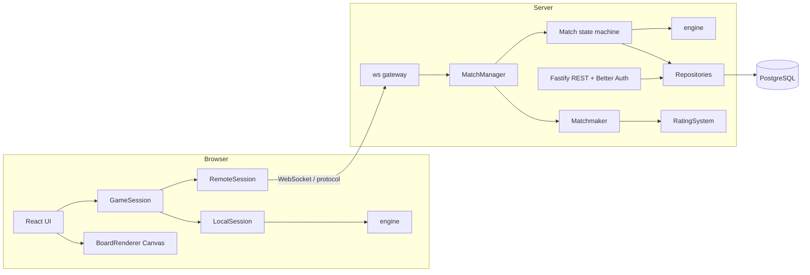
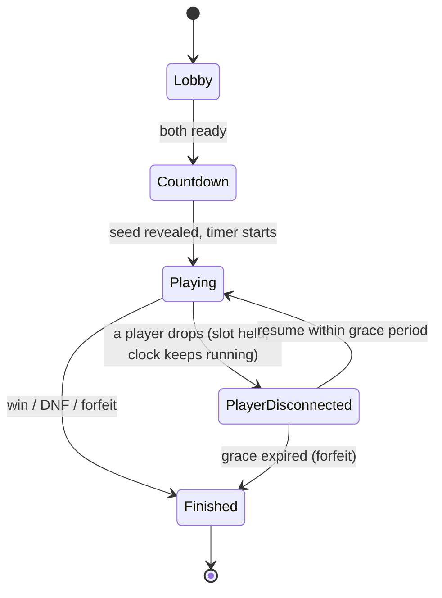

# Architecture

> Status after M1-T03: "Package layout", "Dependency rule", "TypeScript configuration", "Board configuration", "Board and neighbor math" and "Game state, views and events" describe what exists in the repository today. The other sections are the approved design (spec section 4) and the canonical names from the master plan; that code is planned and not yet implemented. Engine code arrives task by task through M1 and M2. When an interface changes, the task that changes it updates this file.

## Principles

Spec section 4.1. Each is enforced by lint, by tests or by the package layout, not by good intentions.

1. **Deterministic engine.** `(seed, config, commands) -> state`. No clocks, no `Math.random`, no DOM, no Node APIs. Time is supplied by the caller as `t` on each command. The PRNG is implemented inside the engine with integer arithmetic.
2. **Server-authoritative play.** The server holds the real board; clients receive only revealed cells. Mine positions never reach a browser while a game is in progress. After a game ends, only the player's own finished game may expose its mines. In a race both players share one board, so until D-14 is settled (M4-T03, ADR-010) the layout is released only when the match result is final for both players.
3. **One session interface.** The UI talks to `GameSession`. `LocalSession` runs the engine in the browser; `RemoteSession` speaks the protocol over WebSocket. Moving from local to LAN to online changes the session, not the UI.
4. **Replay-based validation.** Every game is a command log. Ranked solo runs are verified by replaying the log through the same engine.
5. **Strict inward dependencies.** `engine` imports nothing project-internal; `protocol` imports only engine types; `server` and `web` depend on both (see "Dependency rule").

## System diagram

Spec section 4.3.



## Match lifecycle

Spec section 4.4. The match is a State pattern on the server.



The race clock never pauses. A player who drops keeps their slot for the grace period (D-05, working value 30 s) but loses time while away, which keeps the race fair to the opponent.

## Engine domain model

Spec section 4.5.

- `BoardConfig` (width, height, mineCount), `Board`, and index-addressed cells with a state of hidden, revealed or flagged.
- `BoardGenerator` (interface) with `SeededBoardGenerator`, an in-engine PRNG and a `SafeOpeningPolicy`.
- `Game` (aggregate): `apply(command)` returns `GameEvent[]` and owns win and loss detection.
- Commands `reveal`, `flag` and `chord`, each with `{ index, t }`. Events `CellsRevealed`, `FlagToggled`, `GameWon`, `GameLost`.
- `GameMode` (Strategy): rules, scoring and result evaluation, with `RaceMode` and `TimeAttackMode`, found through a small `ModeRegistry`.
- Flood fill is iterative (explicit stack), never recursive.

## Data flow: one race click

Spec section 4.6.

1. The client click makes `RemoteSession` send `{ type: "cmd", seq, cmd }` without waiting for earlier acknowledgments (pipelining).
2. The server validates the message against the Zod schema, rate-limits it and stamps the receive time.
3. `Match` routes the command to that player's `Game`; the engine returns events.
4. The server sends the acting player the newly revealed cells (with their values) and the opponent only a progress count.
5. On a win or DNF the server finalizes the result, persists the match and both command logs, and updates ratings.

## Reconnection

Spec section 4.7. Each player holds a resume token and the last acknowledged `seq`. On reconnect within the grace period the server sends a snapshot of that player's revealed state and resumes the match. Opening the game in a second tab with the same token is a takeover: exactly one live connection remains.

## Design patterns

Spec section 4.8. Not used on purpose: Singleton, Visitor, Decorator, and a Factory for cells.

| Pattern | Where | Simpler alternative |
|---|---|---|
| Command | Engine actions, replay, wire format | None; backbone |
| State | Match lifecycle; client screen flow (enum + switch is enough there) | Enum + switch |
| Strategy | `GameMode`, `BoardGenerator`, `RatingSystem` | Config flags (insufficient once versus mode exists) |
| Observer | Engine events to renderer, audio, network, stats | Typed event emitter, no framework |
| Adapter | `GameSession` (Local/Remote), `Transport` over WebSocket | None; the local-to-online seam |
| Repository | `UserRepository`, `MatchRepository`, `ReplayRepository` | Thin data-access module |

## Canonical names

Copied from the master plan (section D), plus the additions listed below. Tasks use these names exactly. A rename requires updating this table and every consumer in the same task. **Status: partly implemented.** M1-T01 created `CellIndex`, `BoardConfig`, `PRESETS` and `InvalidBoardConfigError`, and the three helpers it added: `validateBoardConfig`, `cellCount` and `safeCellCount`. M1-T02 created `Board` and added no other name. M1-T03 created `Game`, `GameStatus`, `GameView`, `CellView`, `GameEvent` and its four variants `CellsRevealed`, `FlagToggled`, `GameWon` and `GameLost`, all names already in the table, and added no other public name. The tasks of M1 to M8 create the rest. The throwaway `m0SampleAdd` in `engine` is not a canonical name; M1-T07 removes it.

**Additions to the master plan's table.** M1-T01 names three functions the plan's table lacks (`validateBoardConfig`, `cellCount`, `safeCellCount`); they are in the `engine` row below. The plan itself is unchanged.

| Package | Names |
|---|---|
| `engine` | `CellIndex` (number, `y * width + x`), `BoardConfig { width; height; mineCount }`, `PRESETS` (`beginner` 9x9/10, `intermediate` 16x16/40, `expert` 30x16/99), `InvalidBoardConfigError`, `validateBoardConfig`, `cellCount`, `safeCellCount`, `Board`, `Game`, `GameStatus` (`'ready' \| 'playing' \| 'won' \| 'lost'`), `GameView`, `CellView`, `Command` (`{ type: 'reveal' \| 'flag' \| 'chord'; index: CellIndex; t: number }`), `GameEvent` (`CellsRevealed`, `FlagToggled`, `GameWon`, `GameLost`), `GameResult`, `Prng`, `createPrng`, `BoardGenerator`, `GeneratedBoard`, `SeededBoardGenerator`, `SafeOpeningPolicy`, `createGame`, `ReplayLog`, `replay`, `validateReplayLog`, `GameMode`, `ModeId` (`'race' \| 'time-attack'`), `PlayerResult`, `MatchOutcome`, `ModeRegistry`, `RaceMode`, `TimeAttackMode`, `GhostPlayer`, `Clock` (interface only) |
| `protocol` | `PROTOCOL_VERSION`, `ClientMessageSchema`, `ServerMessageSchema`, `encodeMessage`, `decodeMessage`, `Transport`, `InMemoryTransport`, `FaultyTransport` |
| `apps/web` | `GameSession`, `PlayerAction` (`{ type: Command['type']; index: CellIndex }`), `LocalSession`, `RemoteSession`, `ViewMirror`, `BoardRenderer`, `CanvasBoardRenderer`, `InputController`, `StatsStore`, `SystemClock` |
| `apps/server` | `Match`, `MatchState`, `MatchManager`, `Matchmaker`, `RatingSystem`, `Glicko2RatingSystem`, `ReplayValidator`, `StatsService`, `UserRepository`, `MatchRepository`, `ReplayRepository`, `SystemClock` |

## Public interfaces today

| Package | Exports now | Arrives |
|---|---|---|
| `engine` | `CellIndex`, `BoardConfig`, `PRESETS`, `validateBoardConfig`, `cellCount`, `safeCellCount`, `InvalidBoardConfigError` (M1-T01); `Board` (M1-T02); `Game`, `GameStatus`, `GameView`, `CellView`, `GameEvent`, `CellsRevealed`, `FlagToggled`, `GameWon`, `GameLost` (M1-T03); `m0SampleAdd` (M0 pipeline sample, not a canonical name) | rest of the surface from M1-T04; API-surface test in M1-T07 |
| `protocol` | nothing | M5-T01 |
| `apps/server` | nothing | M5-T03 |
| `apps/web` | nothing | M3-T01 |

`engine` and `protocol` expose their public API from a single `index.ts` each, guarded by an API-surface test (M1-T07). Every exported symbol carries a TSDoc comment (spec section 7.2); the generated reference is a CI artifact, never committed.

## Board configuration

Implemented in M1-T01 (`packages/engine/src/config.ts`, `errors.ts`).

- `CellIndex` is a plain number, `y * width + x`, counted row by row from the top-left.
- `BoardConfig { width; height; mineCount }` has `readonly` fields. `PRESETS` holds the three classic boards (D-01 working values) and is deeply frozen.
- `validateBoardConfig(config)` returns nothing and throws `InvalidBoardConfigError` unless `width` and `height` are integers from 1 to 100 and `mineCount` is an integer from 0 to `width * height - 1`. One-row boards, one-column boards and a single cell are legal. The check stops at the first problem, in the order width, height, mineCount.
- `InvalidBoardConfigError` extends `Error` and carries `reason`, which is also its `message` and always starts with the offending field's name.
- This is the basic check only. A board with a guaranteed safe opening needs more safe cells than one; that stricter limit belongs to the generator (M2-T02).
- `cellCount(config)` and `safeCellCount(config)` are plain arithmetic and do not validate; callers validate first.

## Board and neighbor math

Implemented in M1-T02 (`packages/engine/src/board.ts`).

- `new Board(config, mines)` is an immutable mine layout. It knows where the mines are and nothing about reveals or flags (that is `Game`, M1-T03), so one `Board` can be shared by many games. It keeps a frozen copy of the config and its own copy of the mines (a `Uint8Array`, one byte per cell).
- **Construction checks, in this order:** `validateBoardConfig`; then every mine index; then the number of distinct mines. Repeated indices collapse into one mine before the count is compared with `config.mineCount`, so `[5, 5]` for two mines is rejected and `[5, 5, 6]` for two mines is accepted as the mines 5 and 6. Reading stops as soon as the list holds more distinct mines than `mineCount`, so an endless iterable cannot hang it.
- **Errors.** An invalid config, or a distinct-mine count that differs from `mineCount`, throws `InvalidBoardConfigError`; its `reason` starts with the field name (`mineCount`). A mine index, an argument index or a coordinate that is not a whole number inside the board throws `RangeError`, the same error the commands use for an out-of-range index (M1 handoff, "Command semantics"). No new error class was added.
- **Methods.** `isMine(i)`, `neighbors(i)`, `adjacentMines(i)`, `indexOf(x, y)`, `coordsOf(i)` and `readonly config`. All of them validate their argument. `indexOf` rejects `x >= width` rather than wrapping into the next row.
- **Neighbors** are the up to 8 cells that touch a cell, in ascending index order; a corner has 3, an edge cell 5, an interior cell 8, and a one-row or one-column board has at most 2. Each list is computed on first use, frozen, and cached, so later calls return the same array and allocate nothing. `adjacentMines(i)` counts mine neighbors and ignores the cell's own mine.
- `Board` holds mine positions. It stays on the server or inside the local engine and is never sent to a client during a game (`CLAUDE.md`, rule 8); clients see `GameView`.

## Game state, views and events

Implemented in M1-T03 (`packages/engine/src/game.ts`, `view.ts`, `events.ts`). The commands that change a game (`apply`) arrive in M1-T04 to M1-T06; until then a new game stays `'ready'` with every cell hidden.

- `new Game(board)` holds one state code per cell (hidden, revealed or flagged), the `GameStatus` and an event emitter. It shares the immutable `Board` and never exposes it, so reading a `Game` cannot reveal mines. Methods so far: `subscribe(listener)` and `view()`.
- `GameView` is `{ width; height; status; cells; revealedCount; flagCount; minesRemaining; exposedMines? }`. `cells` is in index order. `CellView` is `{ state: 'hidden' }`, `{ state: 'flagged' }` or `{ state: 'revealed'; value }`. A hidden cell carries nothing about mines, and a flag looks the same on a mine and on a safe cell. `minesRemaining` is the mine count minus the flags and goes negative with too many flags.
- `view()` returns a new, deeply frozen snapshot on every call. `exposedMines` is a key that exists only when `status` is `'won'` or `'lost'`; then it lists every mine, ascending. The view is built by the internal pure function `buildGameView(board, cellStates, status)`, which derives the counts from the cells so they cannot disagree.
- **Race caveat (D-14).** The engine fills `exposedMines` as soon as a player's own game ends. In a race both players share one board, so the server must withhold `exposedMines` until the match result is final for both players, until ADR-010 (M4-T03) says otherwise. That filter belongs to the server (M5-T05), not to the engine.
- `GameEvent` is a union discriminated by `type`: `CellsRevealed { type: 'cellsRevealed'; cells: { index; value }[] }`, `FlagToggled { type: 'flagToggled'; index; flagged }`, `GameWon { type: 'gameWon'; t }` and `GameLost { type: 'gameLost'; t; mineIndex }`. The docs name the variants but not the `type` strings; the camel-case strings are a choice of M1-T03.
- `game.subscribe(listener)` returns an unsubscribe function (Observer). Listeners are called in subscription order. Delivery works on a copy of the list, so subscribing or unsubscribing during an event changes the next event, not the current one. If a listener throws, the others are still called and the first error is rethrown afterwards. The emitter, `GameEventEmitter`, is internal and not exported from `index.ts`.

## Known limits

- **D-10, ping fairness.** Higher-latency players are disadvantaged in a race. Command pipelining and server timestamps reduce this but do not remove it. Accepted for the MVP; measured in M5-T08 and M11-T02, and this section is updated with the numbers.
- **Solver bots.** Hidden mines, rate limits, impossible-speed flags and replay audits reduce cheating, but a bot that plays by deduction cannot be detected reliably. A known limit, not a bug.

## Package layout

pnpm workspaces, strict TypeScript, ESM everywhere (`"type": "module"`). Spec section 4.2.

| Directory | npm name | Role | Depends on (workspace) |
|---|---|---|---|
| `packages/engine` | `@minesweeper/engine` | Pure, deterministic game logic. No DOM, Node APIs, clocks or `Math.random`. | nothing |
| `packages/protocol` | `@minesweeper/protocol` | Wire-message schemas and shared types. | `engine` (types only) |
| `apps/server` | `@minesweeper/server` | Authoritative game server (Fastify and `ws`). | `engine`, `protocol` |
| `apps/web` | `@minesweeper/web` | Browser client (React, Vite, Canvas 2D). | `engine`, `protocol` |

The `@minesweeper/` scope is a naming choice made in M0-T02; the plan's canonical-names table covers symbols, not package names.

## Dependency rule

```
engine  <-  protocol  <-  apps/server
                      <-  apps/web
```

Dependencies only point inward. `apps/server` and `apps/web` never depend on each other, and nothing depends on an app. This is enforced twice. By `package.json` and TypeScript project references (M0-T02): pnpm links only declared dependencies, so an undeclared import fails to typecheck (TS2307). By lint rules (M0-T03, `eslint.config.js`): `engine` may import nothing project-internal and no Node built-ins, `protocol` may import only `@minesweeper/engine`, and the two apps may not import each other, by package name or relative path. Each rule is pinned by a fixture in `tools/lint-fixtures/`.

## TypeScript configuration

- `tsconfig.base.json` holds the shared strict options: `strict`, `noUncheckedIndexedAccess`, `exactOptionalPropertyTypes`, `verbatimModuleSyntax`.
- The root `tsconfig.json` is solution-style (`files: []`, references to all four packages). `pnpm typecheck` and `pnpm build` both run `tsc -b`, which builds referenced projects first.
- `engine` and `protocol` are `composite` projects emitting to `dist/` (ignored by git), with `lib: ["ES2023"]` and `types: []`. With no DOM lib and no ambient `@types`, using `document`, `window` or `process` in them is a compile error. This backs the engine's purity rule (spec section 4.1) in addition to the lint bans from M0-T03 (`Math.random`, `Date`, `performance`, `window`, `document`, `process`, also through `globalThis`; test files may read the clock).
- `apps/server` uses Node module resolution (`NodeNext`) and `types: ["node"]`.
- `apps/web` uses `Bundler` resolution, the DOM lib, `jsx: react-jsx` and `noEmit`; Vite does the real build from M3-T01.
- Test files are not part of the `tsc -b` build of `engine` and `protocol` (excluded in their `tsconfig.json`). `tsconfig.test.json` in each package type-checks them without emitting, and `tsconfig.tooling.json` at the root checks `vitest.config.ts`. `pnpm typecheck` runs all of them (M0-T04).
- Packages `engine` and `protocol` expose one public entry point through `exports` (`dist/index.js`, `dist/index.d.ts`); consumers import the package name, never a deep path.
