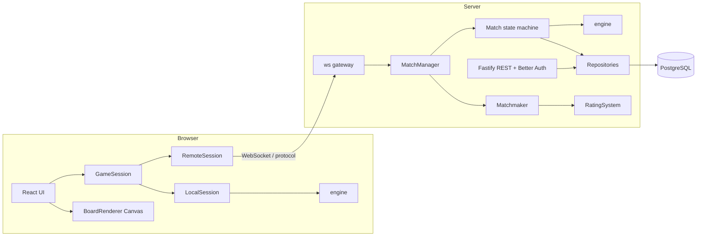
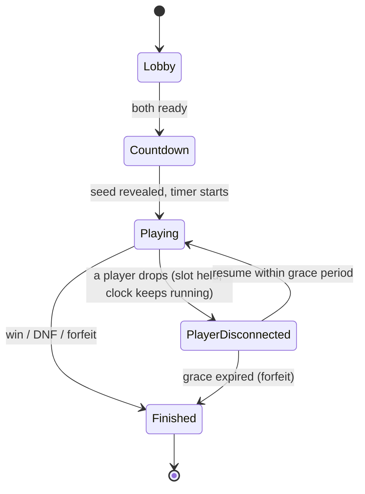

# Architecture

> Status after M2-T03: "Package layout", "Dependency rule", "TypeScript configuration", "Board configuration", "Board and neighbor math", "Game state, views and events", "Reveal and flood fill", "Flags and chording", "Win, loss and the end of a game", "Public API of the engine", "Seeded randomness", "Board generation", "Game creation and the command log" and "Replay and validation" describe what exists in the repository today. The other sections are the approved design (spec section 4) and the canonical names from the master plan; that code is planned and not yet implemented. Engine code arrives task by task through M1 and M2. When an interface changes, the task that changes it updates this file.

## Principles

Spec section 4.1. Each is enforced by lint, by tests or by the package layout, not by good intentions.

1. **Deterministic engine.** `(seed, config, commands) -> state`. No clocks, no `Math.random`, no DOM, no Node APIs. Time is supplied by the caller as `t` on each command. The PRNG is implemented inside the engine with integer arithmetic.
2. **Server-authoritative play.** The server holds the real board; clients receive only revealed cells. Mine positions never reach a browser while a game is in progress. After a game ends, only the player's own finished game may expose its mines. In a race both players share one board, so until D-14 is settled (M4-T03, ADR-010) the layout is released only when the match result is final for both players.
3. **One session interface.** The UI talks to `GameSession`. `LocalSession` runs the engine in the browser; `RemoteSession` speaks the protocol over WebSocket. Moving from local to LAN to online changes the session, not the UI.
4. **Replay-based validation.** Every game is a command log. Ranked solo runs are verified by replaying the log through the same engine.
5. **Strict inward dependencies.** `engine` imports nothing project-internal; `protocol` imports only engine types; `server` and `web` depend on both (see "Dependency rule").

## System diagram

Spec section 4.3.



## Match lifecycle

Spec section 4.4. The match is a State pattern on the server.



The race clock never pauses. A player who drops keeps their slot for the grace period (D-05, working value 30 s) but loses time while away, which keeps the race fair to the opponent.

## Engine domain model

Spec section 4.5.

- `BoardConfig` (width, height, mineCount), `Board`, and index-addressed cells with a state of hidden, revealed or flagged.
- `BoardGenerator` (interface) with `SeededBoardGenerator`, an in-engine PRNG and a `SafeOpeningPolicy`.
- `Game` (aggregate): `apply(command)` returns `GameEvent[]` and owns win and loss detection.
- Commands `reveal`, `flag` and `chord`, each with `{ index, t }`. Events `CellsRevealed`, `FlagToggled`, `GameWon`, `GameLost`.
- `GameMode` (Strategy): rules, scoring and result evaluation, with `RaceMode` and `TimeAttackMode`, found through a small `ModeRegistry`.
- Flood fill is iterative (explicit stack), never recursive.

## Data flow: one race click

Spec section 4.6.

1. The client click makes `RemoteSession` send `{ type: "cmd", seq, cmd }` without waiting for earlier acknowledgments (pipelining).
2. The server validates the message against the Zod schema, rate-limits it and stamps the receive time.
3. `Match` routes the command to that player's `Game`; the engine returns events.
4. The server sends the acting player the newly revealed cells (with their values) and the opponent only a progress count.
5. On a win or DNF the server finalizes the result, persists the match and both command logs, and updates ratings.

## Reconnection

Spec section 4.7. Each player holds a resume token and the last acknowledged `seq`. On reconnect within the grace period the server sends a snapshot of that player's revealed state and resumes the match. Opening the game in a second tab with the same token is a takeover: exactly one live connection remains.

## Design patterns

Spec section 4.8. Not used on purpose: Singleton, Visitor, Decorator, and a Factory for cells.

| Pattern | Where | Simpler alternative |
|---|---|---|
| Command | Engine actions, replay, wire format | None; backbone |
| State | Match lifecycle; client screen flow (enum + switch is enough there) | Enum + switch |
| Strategy | `GameMode`, `BoardGenerator`, `RatingSystem` | Config flags (insufficient once versus mode exists) |
| Observer | Engine events to renderer, audio, network, stats | Typed event emitter, no framework |
| Adapter | `GameSession` (Local/Remote), `Transport` over WebSocket | None; the local-to-online seam |
| Repository | `UserRepository`, `MatchRepository`, `ReplayRepository` | Thin data-access module |

## Canonical names

Copied from the master plan (section D), plus the additions listed below. Tasks use these names exactly. A rename requires updating this table and every consumer in the same task. **Status: partly implemented.** M1-T01 created `CellIndex`, `BoardConfig`, `PRESETS` and `InvalidBoardConfigError`, and the three helpers it added: `validateBoardConfig`, `cellCount` and `safeCellCount`. M1-T02 created `Board` and added no other name. M1-T03 created `Game`, `GameStatus`, `GameView`, `CellView`, `GameEvent` and its four variants `CellsRevealed`, `FlagToggled`, `GameWon` and `GameLost`, all names already in the table, and added no other public name. M1-T04 created `Command` (already in the table, with the shape the table gives) and added no other public name. M1-T05 added no public name; `chordCells` and `ChordResult` are internal. M1-T06 added no name at all, public or internal-exported; `GameWon` and the `'won'` status already existed. M1-T07 added no name; it removed the throwaway `m0SampleAdd` (never a canonical name) and locked the surface of M1 (see "Public API of the engine"). M2-T01 created `Prng` and `createPrng`, both already in the table, and added no other name (the internal class behind `createPrng` is not exported from its file). M2-T02 created `BoardGenerator`, `GeneratedBoard`, `SeededBoardGenerator` and `SafeOpeningPolicy`, all already in the table, and added no other public name (`openingZone` is internal). M2-T03 created `createGame`, already in the table, and added no other name: `Game.log()` and the optional `opening` parameter of the `Game` constructor are members of an existing class. M2-T04 created `ReplayLog`, `replay` and `validateReplayLog`, all already in the table, and `InvalidReplayError`, which the task text names and the table lacks (see the additions below); `MAX_REPLAY_COMMANDS` is exported from its file for tests only. The tasks of M2-T05 to M8 create the rest.

**Additions to the master plan's table.** M1-T01 names three functions the plan's table lacks (`validateBoardConfig`, `cellCount`, `safeCellCount`); they are in the `engine` row below. M2-T04 names one error class the table lacks (`InvalidReplayError`, thrown by `validateReplayLog` and `replay`); it is in the `engine` row. The plan itself is unchanged.

| Package | Names |
|---|---|
| `engine` | `CellIndex` (number, `y * width + x`), `BoardConfig { width; height; mineCount }`, `PRESETS` (`beginner` 9x9/10, `intermediate` 16x16/40, `expert` 30x16/99), `InvalidBoardConfigError`, `validateBoardConfig`, `cellCount`, `safeCellCount`, `Board`, `Game`, `GameStatus` (`'ready' \| 'playing' \| 'won' \| 'lost'`), `GameView`, `CellView`, `Command` (`{ type: 'reveal' \| 'flag' \| 'chord'; index: CellIndex; t: number }`), `GameEvent` (`CellsRevealed`, `FlagToggled`, `GameWon`, `GameLost`), `GameResult`, `Prng`, `createPrng`, `BoardGenerator`, `GeneratedBoard`, `SeededBoardGenerator`, `SafeOpeningPolicy`, `createGame`, `ReplayLog`, `replay`, `validateReplayLog`, `InvalidReplayError`, `GameMode`, `ModeId` (`'race' \| 'time-attack'`), `PlayerResult`, `MatchOutcome`, `ModeRegistry`, `RaceMode`, `TimeAttackMode`, `GhostPlayer`, `Clock` (interface only) |
| `protocol` | `PROTOCOL_VERSION`, `ClientMessageSchema`, `ServerMessageSchema`, `encodeMessage`, `decodeMessage`, `Transport`, `InMemoryTransport`, `FaultyTransport` |
| `apps/web` | `GameSession`, `PlayerAction` (`{ type: Command['type']; index: CellIndex }`), `LocalSession`, `RemoteSession`, `ViewMirror`, `BoardRenderer`, `CanvasBoardRenderer`, `InputController`, `StatsStore`, `SystemClock` |
| `apps/server` | `Match`, `MatchState`, `MatchManager`, `Matchmaker`, `RatingSystem`, `Glicko2RatingSystem`, `ReplayValidator`, `StatsService`, `UserRepository`, `MatchRepository`, `ReplayRepository`, `SystemClock` |

## Public interfaces today

| Package | Exports now | Arrives |
|---|---|---|
| `engine` | `CellIndex`, `BoardConfig`, `PRESETS`, `validateBoardConfig`, `cellCount`, `safeCellCount`, `InvalidBoardConfigError` (M1-T01); `Board` (M1-T02); `Game`, `GameStatus`, `GameView`, `CellView`, `GameEvent`, `CellsRevealed`, `FlagToggled`, `GameWon`, `GameLost` (M1-T03); `Command` (M1-T04). That is all of M1: 7 values and 11 types, locked by the API-surface test (M1-T07); `Prng`, `createPrng` (M2-T01); `BoardGenerator`, `GeneratedBoard`, `SeededBoardGenerator`, `SafeOpeningPolicy` (M2-T02); `createGame` (M2-T03), plus `Game.log()` and the `opening` parameter of the `Game` constructor; `ReplayLog`, `replay`, `validateReplayLog`, `InvalidReplayError` (M2-T04). Now 14 values and 15 types | The rest of the surface arrives from M2-T05 on |
| `protocol` | nothing | M5-T01 |
| `apps/server` | nothing | M5-T03 |
| `apps/web` | nothing | M3-T01 |

`engine` and `protocol` expose their public API from a single `index.ts` each, guarded by an API-surface test: the engine's exists since M1-T07, the protocol's arrives with M5-T01. Every exported symbol carries a TSDoc comment (spec section 7.2); the generated reference is a CI artifact, never committed.

## Board configuration

Implemented in M1-T01 (`packages/engine/src/config.ts`, `errors.ts`).

- `CellIndex` is a plain number, `y * width + x`, counted row by row from the top-left.
- `BoardConfig { width; height; mineCount }` has `readonly` fields. `PRESETS` holds the three classic boards (D-01 working values) and is deeply frozen.
- `validateBoardConfig(config)` returns nothing and throws `InvalidBoardConfigError` unless `width` and `height` are integers from 1 to 100 and `mineCount` is an integer from 0 to `width * height - 1`. One-row boards, one-column boards and a single cell are legal. The check stops at the first problem, in the order width, height, mineCount.
- `InvalidBoardConfigError` extends `Error` and carries `reason`, which is also its `message` and always starts with the offending field's name.
- This is the basic check only. A board with a guaranteed safe opening needs more safe cells than one; that stricter limit belongs to the generator (M2-T02).
- `cellCount(config)` and `safeCellCount(config)` are plain arithmetic and do not validate; callers validate first.

## Board and neighbor math

Implemented in M1-T02 (`packages/engine/src/board.ts`).

- `new Board(config, mines)` is an immutable mine layout. It knows where the mines are and nothing about reveals or flags (that is `Game`, M1-T03), so one `Board` can be shared by many games. It keeps a frozen copy of the config and its own copy of the mines (a `Uint8Array`, one byte per cell).
- **Construction checks, in this order:** `validateBoardConfig`; then every mine index; then the number of distinct mines. Repeated indices collapse into one mine before the count is compared with `config.mineCount`, so `[5, 5]` for two mines is rejected and `[5, 5, 6]` for two mines is accepted as the mines 5 and 6. Reading stops as soon as the list holds more distinct mines than `mineCount`, so an endless iterable cannot hang it.
- **Errors.** An invalid config, or a distinct-mine count that differs from `mineCount`, throws `InvalidBoardConfigError`; its `reason` starts with the field name (`mineCount`). A mine index, an argument index or a coordinate that is not a whole number inside the board throws `RangeError`, the same error the commands use for an out-of-range index (M1 handoff, "Command semantics"). No new error class was added.
- **Methods.** `isMine(i)`, `neighbors(i)`, `adjacentMines(i)`, `indexOf(x, y)`, `coordsOf(i)` and `readonly config`. All of them validate their argument. `indexOf` rejects `x >= width` rather than wrapping into the next row.
- **Neighbors** are the up to 8 cells that touch a cell, in ascending index order; a corner has 3, an edge cell 5, an interior cell 8, and a one-row or one-column board has at most 2. Each list is computed on first use, frozen, and cached, so later calls return the same array and allocate nothing. `adjacentMines(i)` counts mine neighbors and ignores the cell's own mine.
- `Board` holds mine positions. It stays on the server or inside the local engine and is never sent to a client during a game (`CLAUDE.md`, rule 8); clients see `GameView`.

## Game state, views and events

Implemented in M1-T03 (`packages/engine/src/game.ts`, `view.ts`, `events.ts`). `Game.apply` arrived in M1-T04 for `reveal`, in M1-T05 for `flag` and `chord`, and win detection and the full post-game rules in M1-T06. `new Game(board)` is `'ready'` with every cell hidden; a game made by `createGame` is `'ready'` with its opening already revealed (see "Game creation and the command log").

- `new Game(board)` holds one state code per cell (hidden, revealed or flagged), the `GameStatus` and an event emitter. It shares the immutable `Board` and never exposes it, so reading a `Game` cannot reveal mines. Methods so far: `subscribe(listener)`, `view()`, `apply(command)` and, from M2-T03, `log()`. The constructor takes an optional `opening` (M2-T03).
- `GameView` is `{ width; height; status; cells; revealedCount; flagCount; minesRemaining; exposedMines? }`. `cells` is in index order. `CellView` is `{ state: 'hidden' }`, `{ state: 'flagged' }` or `{ state: 'revealed'; value }`. A hidden cell carries nothing about mines, and a flag looks the same on a mine and on a safe cell. `minesRemaining` is the mine count minus the flags and goes negative with too many flags.
- `view()` returns a new, deeply frozen snapshot on every call. `exposedMines` is a key that exists only when `status` is `'won'` or `'lost'`; then it lists every mine, ascending. The view is built by the internal pure function `buildGameView(board, cellStates, status)`, which derives the counts from the cells so they cannot disagree.
- **Race caveat (D-14).** Two engine outputs carry mine positions, and the engine fills both as soon as a player's own game ends: `exposedMines` in the view, and `mineIndex` in the `gameLost` event. For a plain `reveal` the second is the cell the player chose; for a chord that loses it is the lowest-index mine among the neighbors the player did not click, so it is one more mine location. In a race both players share one board, so until ADR-010 (M4-T03) says otherwise the server must withhold `exposedMines` and remove `mineIndex` from the `gameLost` it sends until the match result is final for both players. That filter belongs to the server (M5-T05), not to the engine; a `delta` that forwards engine events unchanged would leak (M5-T01 gives the `delta` schema a DNF without a mine index).
- `GameEvent` is a union discriminated by `type`: `CellsRevealed { type: 'cellsRevealed'; cells: { index; value }[] }`, `FlagToggled { type: 'flagToggled'; index; flagged }`, `GameWon { type: 'gameWon'; t }` and `GameLost { type: 'gameLost'; t; mineIndex }`. The docs name the variants but not the `type` strings; the camel-case strings are a choice of M1-T03.
- `game.subscribe(listener)` returns an unsubscribe function (Observer). Listeners are called in subscription order. Delivery works on a copy of the list, so subscribing or unsubscribing during an event changes the next event, not the current one. If a listener throws, the others are still called and the first error is rethrown afterwards. The emitter, `GameEventEmitter`, is internal and not exported from `index.ts`.

## Reveal and flood fill

Implemented in M1-T04 (`packages/engine/src/command.ts`, `reveal.ts`, `game.ts`).

- `Command` is `{ type: 'reveal' | 'flag' | 'chord'; index: CellIndex; t: number }`, the canonical shape, exported from `index.ts`. `t` is milliseconds since the game started, supplied by the caller. From M2-T03 `Game.apply` accepts it only if it is a non-negative safe integer that is not lower than the `t` of the last accepted command, and returns `[]` otherwise (see "Game creation and the command log"); the first check is still the index.
- `game.apply(command)` returns a frozen `readonly GameEvent[]`. The order of checks is fixed: first the index (a value that is not a whole number inside the board throws `RangeError`, for every command type and even after the game is over), then the game status (after a loss, and from M1-T06 after a win, every command returns `[]`), then the command. `flag` and `chord` are described in "Flags and chording"; any unknown `type` (possible only from untyped input) returns `[]`.
- **`reveal`.** A hidden, safe cell is revealed; if it shows 0 the reveal spreads to every hidden neighbor, and onward from each neighbor that also shows 0. Revealed cells are skipped, flagged cells are neither revealed nor passed through, and numbered cells stop the spread. All of it is **one** `cellsRevealed` event listing every newly revealed cell. A command on a revealed or flagged cell returns `[]` and changes nothing.
- **Mines.** `reveal` on a mine sets the status to `'lost'` and returns one `gameLost { t, mineIndex }`; there is no `cellsRevealed` with it. The mine's cell stays hidden in the state array: `CellView` has no mine variant, and counting the mine as revealed would break `revealedCount === safeCellCount` (M1-T06). The player sees mines only through `exposedMines`, which the D-14 caveat above applies to.
- **Status.** The first command that takes effect moves `'ready'` to `'playing'`, or straight to `'lost'` if it hits a mine; a game made by `createGame` already has its opening open (M2-T03). A reveal that opens the last safe cell wins the game (M1-T06, see "Win, loss and the end of a game").
- **Iterative flood fill.** `revealCell(board, cellStates, index)` is internal (`@internal`, not exported from `index.ts`). It works on the raw cell states, so flags could be tested before `Game` could place any, and it is the path M1-T05's chord reuses. It uses an explicit stack, never recursion; a cell is marked revealed when it is found, so each cell is visited once. The listing order is fixed because replays, ghosts and network updates must agree: the clicked cell first, then cells in discovery order, where the most recently found zero cell is expanded first and each cell's neighbors are taken in ascending index order. Tests pin that order and fail a recursive version on the 100x100 board (the largest legal one), which the 480-cell expert board does not.
- **Events and listeners.** State changes before the event is delivered. If a subscriber throws, the others still hear the event and the first error is rethrown from `apply` (see "Game state, views and events"); the game has already changed by then. Events and the cell lists inside them are frozen, so one subscriber cannot alter what the next one sees.

## Flags and chording

Implemented in M1-T05 (`packages/engine/src/chord.ts`, `game.ts`). The rules are decision D-04, recorded in [ADR-009](docs/adr/ADR-009-cell-rules.md).

- **`flag`.** Toggles a hidden cell to flagged and back to hidden, with one `flagToggled { index; flagged }` event. On a revealed cell it returns `[]`. Flags may be placed anywhere hidden, so `flagCount` can exceed the mine count and `minesRemaining` goes negative. A flag looks the same on a mine and on a safe cell. There are no question marks, and flags are never required to win. A flag that takes effect moves `'ready'` to `'playing'`, so a game can be `'playing'` with nothing revealed.
- **`chord`.** Takes effect only on a revealed cell that shows 1 or more, when the number of flagged neighbors equals that number and at least one neighbor is hidden and unflagged. Anything else (a hidden or flagged cell, a zero, too few or too many flags, nothing left to open) returns `[]` and changes nothing. A revealed zero can still have a hidden neighbor, because a flag can be removed after a cascade; the zero rule keeps that chord a no-op.
- **What a chord opens.** Every hidden unflagged neighbor, through `revealCell`, in ascending index order. A neighbor opened by an earlier neighbor's cascade is skipped, so each cell is listed once. All of it is **one** `cellsRevealed` event.
- **A chord that reaches a mine.** Flags are counted, never checked against the mines, so a wrong flag leaves a mine to open. The safe neighbors are still opened first; then the status becomes `'lost'`. The events are `cellsRevealed` (only if a cell was opened) then one `gameLost` with the lowest-index mine reached as `mineIndex`. A chord sends at most two events, and `gameLost` is last. The mine cells stay hidden in the cell states, as after a plain `reveal`. `revealedCount` after such a chord includes the safe neighbors it opened, which matters for the D-02 tie-break (ADR-010).
- **Delivery.** `Game` announces all events of a command through one internal step: each event reaches every subscriber, and if subscribers throw, the first error is rethrown after the last event has been delivered.
- **Internal.** `chordCells(board, cellStates, index)` and `ChordResult` work on the raw cell states like `revealCell`, are `@internal` and are not exported from `index.ts`. A chord that opens the last safe cell wins the game, like a reveal does (M1-T06).

## Win, loss and the end of a game

Implemented in M1-T06 (`packages/engine/src/game.ts`). No ADR and no new name: the rules follow from the task text, ADR-009 and `CLAUDE.md`, rule 8.

- **Win.** The game is won when the number of revealed cells equals `safeCellCount(config)`, whichever command reveals the last one: a plain `reveal`, a cascade, or a `chord`. `Game` keeps a running count, so detection does not scan the board. Flags play no part: they are never required, and a flag on a safe cell keeps that cell closed until the flag is removed (a `reveal` on a flagged cell does nothing), so the game cannot be won while one is there.
- **Events.** The command that wins sends `cellsRevealed` followed by one `gameWon { t }`, with `t` taken from that command. The docs did not fix this order; it mirrors a losing chord, where `gameLost` is also last. All events of a command go through one internal step, `#settle`, so every event reaches every subscriber even if one throws (the delivery rule of ADR-009). A winning `reveal` is therefore up to two events where it was one before; a win on a 1x1 board with no mine is `cellsRevealed` then `gameWon` from one command.
- **Loss wins over win on paper only.** A command that reaches a mine is a loss. It can reach a mine only when a flag sits on a safe cell (a chord needs as many flags as the number shows, and an unflagged mine next to it means one flag is off a mine), and that cell is still closed, so a losing command can never also complete the board. A property test pins `lost` implies `revealedCount < safeCellCount`.
- **Final status.** `'won'` and `'lost'` never change. Every later command of any type returns `[]`, delivers nothing and leaves the view identical; only an index outside the board still throws `RangeError` (the index check comes first). Status moves only forwards: `'ready'`, `'playing'`, then `'won'` or `'lost'`, and a game can end on its first command.
- **Mines after the end.** A won game exposes its mines like a lost one: `exposedMines` lists every mine, ascending, because it is the player's own finished game (`CLAUDE.md`, rule 8). The D-14 caveat in "Game state, views and events" applies unchanged, to `exposedMines` and to `gameLost.mineIndex`: in a race the server withholds them until the match result is final for both players (M5-T05).
- **Not in the engine.** Rejecting commands "before the start signal" (Review Focus #2) is a match concern: the lobby and countdown live in `Match` (M5-T04, M6-T04). In the engine the only pre-start state is `'ready'`, and the first command that takes effect starts the game. What the engine does check since M2-T03 is the order of `t` (see "Game creation and the command log").
- **Tests.** `lifecycle.test.ts` (examples, including every command type on every cell after a win and after a loss) and `game.property.test.ts` (fast-check, 1,000 cases per property): no throw for in-range indices, `revealedCount` never decreases and no cell is announced twice, no mine is ever revealed, the mine layout never changes, `'won'` exactly when every safe cell is revealed, status only moves forwards, finished games ignore everything, and revealing every safe cell in any order always wins. `game.differential.test.ts` (M1-T10) adds a guided player that reads the view and reaches chords and long games (about 650 effective chords in a fixed sample of 1,000 games, where the blind generator gave 3), a guard that fails if that stops being true, and a differential check of `Game` against a short recursive reference written from ADR-009, after every command (events, status, every cell, `exposedMines`; the order of cells inside one event is pinned by `reveal.test.ts` and is not compared).

## Public API of the engine

Implemented in M1-T07 (`packages/engine/src/index.ts`, `api-surface.test.ts`, `public-api.test.ts`, `__snapshots__/api-surface.txt`). No ADR and no new name: the surface is the canonical names that M1 created.

- **What is public.** Exactly 29 names (18 from M1, plus `createPrng` and `Prng` from M2-T01, four from M2-T02, `createGame` from M2-T03 and four from M2-T04). Values: `Board`, `Game`, `InvalidBoardConfigError`, `InvalidReplayError`, `PRESETS`, `SafeOpeningPolicy`, `SeededBoardGenerator`, `cellCount`, `createGame`, `createPrng`, `replay`, `safeCellCount`, `validateBoardConfig`, `validateReplayLog`. Types: `BoardConfig`, `BoardGenerator`, `CellIndex`, `CellsRevealed`, `CellView`, `Command`, `FlagToggled`, `GameEvent`, `GameLost`, `GameStatus`, `GameView`, `GameWon`, `GeneratedBoard`, `Prng`, `ReplayLog`. Everything else in `packages/engine/src` is internal, even where a file exports it for other engine modules or for tests: `GameEventEmitter`, `buildGameView` and the `CELL_*` state codes, `revealCell` and `RevealResult`, `chordCells` and `ChordResult`, `openingZone`, `MAX_REPLAY_COMMANDS`. Consumers import the package name, never a file.
- **The guard.** `api-surface.test.ts` reads `src/index.ts` with the TypeScript compiler API and renders every export (kind, constructor and method signatures, property types, the members of every interface, the right-hand side of every type alias) into text. The text must equal the committed `__snapshots__/api-surface.txt`, so adding, removing, renaming or reshaping an export, or changing the shape of `Command`, `GameEvent` or `GameView`, fails the test and shows up as a diff in review. Three more checks: the runtime export names equal the names the declarations call values; a denylist of internal names must stay out of `index.ts`; no exported name may carry `@internal`, because TypeDoc runs with `excludeInternal` and the lint rule for `@example` exempts `@internal`, so such a tag would hide a public name from the reference without any warning (finding N3 of the M0 re-review).
- **Changing the surface on purpose.** The task that adds or reshapes an export edits `index.ts`, runs `pnpm exec vitest run --project engine -u`, reads the diff of the snapshot and explains it in the pull request. CI never writes a snapshot: a missing or different file fails.
- **A consumer's view.** `public-api.test.ts` plays a won game (reveal with a cascade, flag, chord, final reveal), a lost game, unsubscribe and an out-of-range index, and checks the config helpers, importing only from `./index.js`.
- **Coverage.** `vitest.config.ts` sets thresholds for `packages/engine` (95% statements, functions and lines; 90% branches) and excludes the `index.ts` barrels. `pnpm test:coverage` runs in CI, so a task that ships logic without tests turns CI red.
- **Limits of the guard.** The renderer knows classes, functions, constants, interfaces and type aliases; an export of another kind (an enum, a namespace) fails the test until the renderer is extended. A type is shown as the compiler prints it, so an alias of a primitive can appear as the primitive (`CellIndex` is `number`). The test uses the `typescript` package, already a root devDependency, in a test only; the engine's own code imports nothing outside its package.

## Seeded randomness

Implemented in M2-T01 (`packages/engine/src/prng.ts`, `fixtures/prng-vectors.json`, `src/prng.test.ts`). No ADR and no decision: the algorithm choice is the one the task names, under ADR-002.

- **Interface.** `Prng { nextUint32(): number; nextInt(maxExclusive: number): number }` and `createPrng(seed): Prng`, both public. `nextUint32` returns a whole number from 0 to 4294967295. `nextInt(n)` returns 0 to `n - 1`, for `n` a whole number from 1 to 4294967296. There is no way to read or restore the state; to start over, create a new generator from the same seed. Generators never share state.
- **Algorithm.** sfc32 (Chris Doty-Humphrey, PractRand) with its four state words taken from four consecutive outputs of a 32-bit SplitMix (a MurmurHash3 `fmix32`-style finalizer with improved constants, stepped by the Weyl constant `0x9e3779b9`, as collected in bryc's "PRNGs in JavaScript"), and the first 12 sfc32 outputs discarded. Only `Math.imul`, shifts, xor, `| 0` and `>>> 0` on 32-bit values: no floating-point state, no clock, no `Math.random`.
- **Unbiased `nextInt`.** Rejection sampling: draws below `2^32 mod n` are skipped, then the result is `draw % n`. More than half of all draws are kept, so the loop takes under two draws on average and ends with probability 1; the number of draws used depends only on the seed. For `n = 2^32` nothing is rejected.
- **Validation.** A seed that is not a whole number from 0 to 4294967295 (including `NaN`, infinities and non-numbers from untyped input) throws `RangeError` whose message starts with `seed`; `-0` counts as 0. A bad `maxExclusive` throws `RangeError` starting with `maxExclusive`, before anything is drawn, so a caught mistake cannot move the generator and desynchronize a replay.
- **The sequence is a stable contract.** Boards (M2-T02), replays and ghosts are derived from it, so a change to any constant, to the warm-up or to the `nextInt` rule silently invalidates every stored replay (ADR-002). The committed vectors pin it; a change needs a new generator version and an ADR, and `ReplayLog.version` (M2-T04) is the place that records which one a log was made with.
- **Tests.** `prng.test.ts`: golden vectors for seeds 0, 1, 42 and 4294967295 (20 `nextUint32` outputs and 20 `nextInt` results for each of `n` = 2, 6, 1000, 3000000000 and 4294967296; the `n` = 3000000000 vectors contain 5 to 12 rejected draws each, so they pin the rejection rule); a differential check against an exact BigInt reference over 157 seed entries, including seeds above 2^31; range, coverage, bit balance and bias checks; every invalid seed and `maxExclusive`. The fixture was generated once by a scratch script built on a third-party sfc32 (`@thi.ng/random`) and the published splitmix32 text, not on engine code; the fixture's `generatedBy` field says so. The script is not in the repository; the BigInt reference in the test can regenerate the vectors.

## Board generation

Implemented in M2-T02 (`packages/engine/src/generator.ts`, `opening.ts`, `fixtures/boards.json`, `src/generator.test.ts`, `opening.test.ts`, `generator.golden.test.ts`). No ADR and no open decision: the rules follow spec section 2.3, ADR-002 and the task text.

- **Interfaces.** `BoardGenerator { generate(config, seed): GeneratedBoard }` and `GeneratedBoard { board; opening }`. `opening` is a frozen list of the cell(s) revealed at the start; it is the same for every player of a board. Revealing it is part of creating a game (M2-T03), not a logged command. `board` holds the mines and stays server-side or inside the local engine (rule 8, D-14).
- **Opening policy.** `SafeOpeningPolicy` is a class with one method, `select(config, prng)`, so no new canonical name was needed; `SeededBoardGenerator` takes an optional policy (Strategy). It picks one center cell. The center and its existing neighbors (the opening zone, at most 9 cells, 4 in a corner) hold no mine, so the cell shows 0 and cascades. Corners and edges are allowed.
- **Which configs are possible.** A cell can be the center when the cells outside its zone can hold every mine. If no cell can, the generator throws `InvalidBoardConfigError` with a reason starting `mineCount` and saying how many mines fit (9x9: 77; 3x3: 5; a 5x1 row: 3; 2x2: 0). This depends on the config only, never on the seed. The bound is the opening-aware limit that `validateBoardConfig` leaves to the generator; 1xN and 1x1 boards stay legal (Review Focus #4). On dense boards only small-zone cells (corners, then edges) are picked.
- **Algorithm and draw order (a stable contract).** Check the config, then `createPrng(seed)`. One `nextInt` over the candidate cells picks the center (over all cells when every cell qualifies, which the policy detects without a scan). The eligible cells outside the zone are listed in ascending order; mine `k` is placed by a partial Fisher-Yates step: `r = nextInt(eligible - k)`, swap positions `k` and `k + r`. The first `mineCount` positions are the mines. The config is checked before the seed (`RangeError` starting `seed`). A rejected config draws nothing.
- **Stability.** The board and opening for `(config, seed)` must never change: replays, ghosts and races rebuild the board from them (ADR-002). `fixtures/boards.json` pins 22 boards (6 seeds for each preset, a 77-mine 9x9, a row, a column, a single cell) by opening and SHA-256 of the ascending mine list joined by commas. A change needs a new generator version (recorded by `ReplayLog.version`, M2-T04) and an ADR; never edit the fixture to turn a test green. The `BoardGenerator` interface has no id member; the version lives in the log.
- **Tests.** Determinism, exact mine count, opening safe with value 0 and a cascade through `Game`, expert on 100 random seeds, a property that a config works for every seed exactly when the mines fit outside the smallest zone, the dense and tiny boards, bad seeds and configs, a custom policy, a plain reference implementation of the contract compared for 150 seeds over 15 configs, and a loose distribution check over 20,000 seeds. The golden test carries its own SHA-256 (no `node:crypto` in the engine), checked against published vectors (TODO(M2-T06): share it with the browser suite). The fixture was produced by a scratch script outside the repository that runs a plain reference implementation of the contract (not `SeededBoardGenerator`) over `createPrng` and hashes with Node's `crypto`; the generator was compared with it afterwards and agrees on all 22 entries (`DEVELOPMENT_GUIDE.md`: a fixture must not be produced by the code it checks).

## Game creation and the command log

Implemented in M2-T03 (`packages/engine/src/create-game.ts`, `game.ts`, `create-game.test.ts`, `game.log.test.ts`). No ADR and no open decision: the rules follow the task text, ADR-002 and the developer's decision of 2026-11-19 on the status after the opening (option A1, recorded here).

- **`createGame(config, seed, generator?)`** asks the generator (default `new SeededBoardGenerator()`) for `{ board, opening }` and returns `new Game(board, opening)`. Errors from the generator pass through unchanged: `InvalidBoardConfigError` for a config, `RangeError` for a seed.
- **The opening is part of creating the game.** The `Game` constructor takes an optional `opening: readonly CellIndex[]`, reveals those cells with the usual cascade, announces no event, writes nothing to the log and does not move the status. An opening cell that is a mine, or not a whole number inside the board, throws `RangeError`. Without an opening (`new Game(board)`) nothing is revealed, exactly as in M1.
- **Status after the opening (A1).** `'ready'` means that no player command has been accepted yet, so a created game is `'ready'` with cells already open and moves to `'playing'` on the first accepted command. If the opening already reveals every safe cell (a 1x1 board, a board with no mines, or a small board whose cascade reaches everything, and rarely a preset board for some seed), the game is `'won'` at `t = 0` with `exposedMines` set, because a finished game cannot be `'ready'`. No `gameWon` event exists for it; read the status from `view()`. The generator rule stays config-only (M2-T02), so `createGame` never rejects a config because of a seed.
- **`Game.log(): readonly Command[]`** lists the commands that took effect, oldest first. Invalid commands, no-ops, commands after the end of the game, commands with a bad `t` and commands that throw `RangeError` are not in it, and neither is the opening. A command is logged before its events are delivered, so a throwing subscriber cannot lose it. Each call returns a new frozen list of frozen copies holding only `type`, `index` and `t`: the caller's objects and later commands cannot change a list already read. The log has no mine information (D-14 is not affected).
- **The rule for `t` (Review Focus #2).** The order of checks in `apply` is: the index (`RangeError`), whether the game is over (`[]`), `t` (`[]`), then the command. `t` is valid when `Number.isSafeInteger(t)`, `t >= 0` and `t` is not lower than the `t` of the last accepted command; the opening counts as `t = 0`. An equal `t` is allowed. Only an accepted command moves the last `t`, so a no-op or a rejected command does not. Safe integers (and not any integer) were chosen so that every logged `t` is exact in JSON.
- **For later tasks.** M2-T04: `replay` of an empty log is `'ready'`, except for a board that the opening already clears, which replays to `'won'`; the replay rule "a logged command that is rejected throws" holds because the log only has accepted commands. M4-T03 (ADR-010): such a seed gives both players of a race the same `t = 0` win, so the tie-break must cover it. M3-T02: `LocalSession` stamps `t` from its clock and must not send a `t` below the last one it sent; the engine now drops such a command silently.
- **Tests.** `create-game.test.ts` (same seed, opening revealed, `'ready'`, not logged, cleared-at-creation cases with a generator of your own, bad input, the constructor) and `game.log.test.ts` (what is and is not logged, copies and freezing, every kind of bad `t`, the order of checks, and a 1,000-case property: the log is exactly the commands that took effect, `t` never decreases, and applying the log to a fresh game gives the same view). `game.property.test.ts` now generates non-decreasing `t`, because random `t` would make the engine reject most commands and weaken its properties; its assertions are unchanged. `public-api.test.ts` gains a consumer test of `createGame`.

## Replay and validation

Implemented in M2-T04 (`packages/engine/src/replay.ts`, `errors.ts`, `replay.test.ts`, `errors.test.ts`, `public-api.test.ts`). No ADR and no open decision: the rules follow the task text, ADR-002 and the M2-T03 notes. The choices that the task left open are listed under "Choices".

- **`ReplayLog`** is `{ version: 1; config: BoardConfig; seed: number; commands: readonly Command[] }`, all fields `readonly`. `commands` is what `Game.log()` returns; `config` and `seed` are what the game was made with. It is plain data. JSON and Zod belong to `protocol` (M5-T01): the engine takes typed input, but `validateReplayLog` still checks every field at run time, because a typed value read from a database can be wrong.
- **`validateReplayLog(log)`** returns nothing and throws `InvalidReplayError` at the first problem, in this order: `version` (must be `1`), `config` (an object that passes `validateBoardConfig`; the `InvalidBoardConfigError` becomes the `cause`), `seed` (an integer from 0 to 4294967295, the same rule as `createPrng`), `commands` (an array of at most **100,000** entries, `MAX_REPLAY_COMMANDS`; the count is checked before any entry), then each command in order: `type`, `index` (a whole number inside this log's board), `t` (a non-negative safe integer, not lower than the `t` before it; equal is allowed, as in `Game.apply`; the opening counts as `t = 0`). It does not play the log and does not run the generator.
- **`replay(log, generator?)`** validates, builds the game with `createGame(config, seed, generator)` and applies every command. It returns the `Game`, so `view()` and `log()` work as for a live game; for a valid log `replay(log).view()` equals the view of the game that made it, and `replay(log).log()` equals `log.commands`. The result record (`GameResult`) joins this guarantee in M2-T05.
- **A log holds only accepted commands.** `Game.log()` never contains a command that changed nothing, came after the end, or had a bad `t`. So a command that the game answers with `[]` during `replay` means the log was not made by this engine, or was edited, and `replay` throws `InvalidReplayError` (reason starts `commands[i]`, and says "already won" or "already lost" when the game was over). It never skips a command: a validator that ignored commands would accept a log whose result nobody played.
- **`InvalidReplayError`** extends `Error` and carries `reason`, which is also its `message`; it always starts with where the problem is (`version`, `config`, `seed`, `commands`, `commands[i]`, or `commands[i].t` and so on). It has its own class, not `InvalidBoardConfigError`: a bad log is bad input from outside. It accepts the standard `cause`.
- **Empty log.** It replays to the game `createGame` returns: `'ready'` with the opening open. On a board that the opening already clears (M2-T03: a 1x1 board, a board with no mines, a small board whose cascade reaches everything, and rarely a preset board for some seed) the game is `'won'` at `t = 0`, so an empty log replays to `'won'` and any command in a log for that board is rejected. ADR-010 must cover the matching tie at `t = 0` in a race.
- **Versioning rule.** `version: 1` is a promise about every rule a stored log depends on: the `Prng` sequence (M2-T01), the board and opening of `SeededBoardGenerator` (M2-T02), how `createGame` starts a game and what status it has (M2-T03), the rules of `Game.apply` (ADR-009) and the rule for `t`. A change that gives a different game for the same log needs a new version number and an ADR that supersedes the generator-stability and game-creation notes in `DECISIONS.md`; `replay` must keep playing every older version. Today only `1` exists and `validateReplayLog` rejects everything else. The log carries no generator id; the version is that id (M2-T02).
- **Choices the task left open.** (1) A config that is valid but leaves no room for a safe opening passes `validateReplayLog` (it does not run the generator) and is rejected by `replay` as an `InvalidReplayError` whose reason starts `config` and whose `cause` is the generator's `InvalidBoardConfigError`, so a caller catches one error type for a bad log; any other error of a custom generator passes through unchanged. (2) "Maximum command count (default 100,000)" is one fixed limit, not a parameter: `validateReplayLog(log)` keeps the signature of the task text. (3) `type` is validated too, though the task does not list it, so that an unknown type gives a precise reason before any game is played. (4) `MAX_REPLAY_COMMANDS` is exported from `replay.ts` for the tests and kept out of `index.ts` (the API-surface test lists it as not public).
- **Tests.** `replay.test.ts` (95 tests): every validation failure with the position in the reason, the fixed order of checks, the limits (100,000 accepted, 100,001 rejected before any entry is read), a scripted win on a hand-made board that uses `reveal`, `flag` and `chord`, a loss, a preset game played to a win, the empty and the cleared-at-creation log, every kind of command the game rejects, the generator rules above, a frozen log, and three properties of fast-check (round trip of random and guided games over 1,000 cases; the same through JSON; an accepted reveal repeated right after itself is rejected at that position). `errors.test.ts` and `public-api.test.ts` gain tests of the new class and of a consumer that imports only `./index.js`. The round trip over fuzzed games in both Node and a browser is M2-T06.

## Known limits

- **D-10, ping fairness.** Higher-latency players are disadvantaged in a race. Command pipelining and server timestamps reduce this but do not remove it. Accepted for the MVP; measured in M5-T08 and M11-T02, and this section is updated with the numbers.
- **Solver bots.** Hidden mines, rate limits, impossible-speed flags and replay audits reduce cheating, but a bot that plays by deduction cannot be detected reliably. A known limit, not a bug.

## Package layout

pnpm workspaces, strict TypeScript, ESM everywhere (`"type": "module"`). Spec section 4.2.

| Directory | npm name | Role | Depends on (workspace) |
|---|---|---|---|
| `packages/engine` | `@minesweeper/engine` | Pure, deterministic game logic. No DOM, Node APIs, clocks or `Math.random`. | nothing |
| `packages/protocol` | `@minesweeper/protocol` | Wire-message schemas and shared types. | `engine` (types only) |
| `apps/server` | `@minesweeper/server` | Authoritative game server (Fastify and `ws`). | `engine`, `protocol` |
| `apps/web` | `@minesweeper/web` | Browser client (React, Vite, Canvas 2D). | `engine`, `protocol` |

The `@minesweeper/` scope is a naming choice made in M0-T02; the plan's canonical-names table covers symbols, not package names.

## Dependency rule

```
engine  <-  protocol  <-  apps/server
                      <-  apps/web
```

Dependencies only point inward. `apps/server` and `apps/web` never depend on each other, and nothing depends on an app. This is enforced twice. By `package.json` and TypeScript project references (M0-T02): pnpm links only declared dependencies, so an undeclared import fails to typecheck (TS2307). By lint rules (M0-T03, `eslint.config.js`): `engine` may import nothing project-internal and no Node built-ins, `protocol` may import only `@minesweeper/engine`, and the two apps may not import each other, by package name or relative path. Each rule is pinned by a fixture in `tools/lint-fixtures/`.

## TypeScript configuration

- `tsconfig.base.json` holds the shared strict options: `strict`, `noUncheckedIndexedAccess`, `exactOptionalPropertyTypes`, `verbatimModuleSyntax`.
- The root `tsconfig.json` is solution-style (`files: []`, references to all four packages). `pnpm typecheck` and `pnpm build` both run `tsc -b`, which builds referenced projects first.
- `engine` and `protocol` are `composite` projects emitting to `dist/` (ignored by git), with `lib: ["ES2023"]` and `types: []`. With no DOM lib and no ambient `@types`, using `document`, `window` or `process` in them is a compile error. This backs the engine's purity rule (spec section 4.1) in addition to the lint bans from M0-T03 (`Math.random`, `Date`, `performance`, `window`, `document`, `process`, also through `globalThis`; test files may read the clock).
- `apps/server` uses Node module resolution (`NodeNext`) and `types: ["node"]`.
- `apps/web` uses `Bundler` resolution, the DOM lib, `jsx: react-jsx` and `noEmit`; Vite does the real build from M3-T01.
- Test files are not part of the `tsc -b` build of `engine` and `protocol` (excluded in their `tsconfig.json`). `tsconfig.test.json` in each package type-checks them without emitting, and `tsconfig.tooling.json` at the root checks `vitest.config.ts`. `pnpm typecheck` runs all of them (M0-T04). The engine's `tsconfig.test.json` sets `resolveJsonModule` (M2-T01) so tests can import golden fixtures from `packages/engine/fixtures/` with `import ... with { type: 'json' }`; engine code, including tests, may not use `node:fs`, and the same import works in a browser runner (M2-T06).
- Packages `engine` and `protocol` expose one public entry point through `exports` (`dist/index.js`, `dist/index.d.ts`); consumers import the package name, never a deep path.
