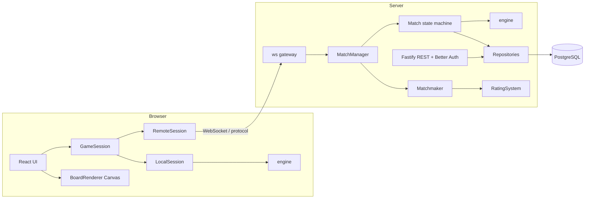
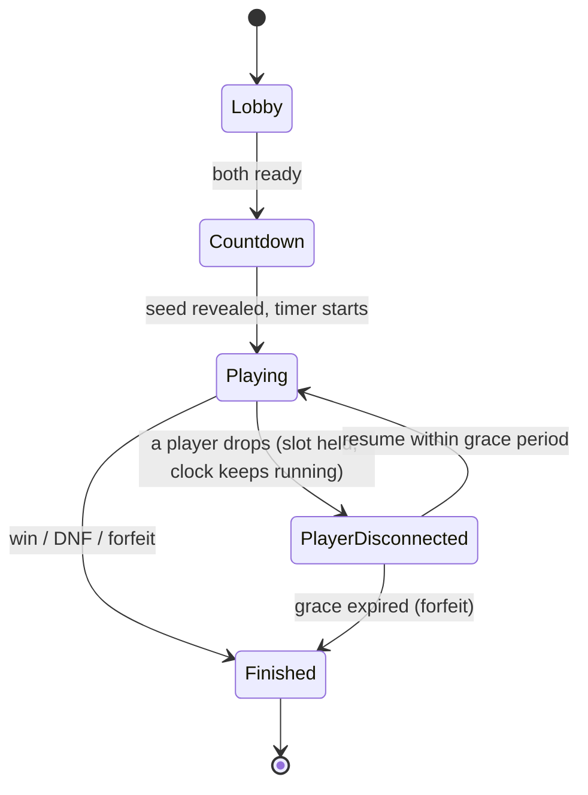

# Architecture

> Status after M3-T04: "Package layout", "Dependency rule", "TypeScript configuration", "Board configuration", "Board and neighbor math", "Game state, views and events", "Reveal and flood fill", "Flags and chording", "Win, loss and the end of a game", "Public API of the engine", "Seeded randomness", "Board generation", "Game creation and the command log", "Replay and validation", "Results and scoring", "Determinism tests", "Web client", "Game session" and "Rendering" and "Input controller" describe what exists in the repository today. The other sections are the approved design (spec section 4) and the canonical names from the master plan; that code is planned and not yet implemented. Engine code arrives task by task through M1 and M2. When an interface changes, the task that changes it updates this file.

## Principles

Spec section 4.1. Each is enforced by lint, by tests or by the package layout, not by good intentions.

1. **Deterministic engine.** `(seed, config, commands) -> state`. No clocks, no `Math.random`, no DOM, no Node APIs. Time is supplied by the caller as `t` on each command. The PRNG is implemented inside the engine with integer arithmetic.
2. **Server-authoritative play.** The server holds the real board; clients receive only revealed cells. Mine positions never reach a browser while a game is in progress. After a game ends, only the player's own finished game may expose its mines. In a race both players share one board, so until D-14 is settled (M4-T03, ADR-010) the layout is released only when the match result is final for both players.
3. **One session interface.** The UI talks to `GameSession`. `LocalSession` runs the engine in the browser; `RemoteSession` speaks the protocol over WebSocket. Moving from local to LAN to online changes the session, not the UI.
4. **Replay-based validation.** Every game is a command log. Ranked solo runs are verified by replaying the log through the same engine.
5. **Strict inward dependencies.** `engine` imports nothing project-internal; `protocol` imports only engine types; `server` and `web` depend on both (see "Dependency rule").

## System diagram

Spec section 4.3.



## Match lifecycle

Spec section 4.4. The match is a State pattern on the server.



The race clock never pauses. A player who drops keeps their slot for the grace period (D-05, working value 30 s) but loses time while away, which keeps the race fair to the opponent.

## Engine domain model

Spec section 4.5.

- `BoardConfig` (width, height, mineCount), `Board`, and index-addressed cells with a state of hidden, revealed or flagged.
- `BoardGenerator` (interface) with `SeededBoardGenerator`, an in-engine PRNG and a `SafeOpeningPolicy`.
- `Game` (aggregate): `apply(command)` returns `GameEvent[]` and owns win and loss detection.
- Commands `reveal`, `flag` and `chord`, each with `{ index, t }`. Events `CellsRevealed`, `FlagToggled`, `GameWon`, `GameLost`.
- `GameMode` (Strategy): rules, scoring and result evaluation, with `RaceMode` and `TimeAttackMode`, found through a small `ModeRegistry`.
- Flood fill is iterative (explicit stack), never recursive.

## Data flow: one race click

Spec section 4.6.

1. The client click makes `RemoteSession` send `{ type: "cmd", seq, cmd }` without waiting for earlier acknowledgments (pipelining).
2. The server validates the message against the Zod schema, rate-limits it and stamps the receive time.
3. `Match` routes the command to that player's `Game`; the engine returns events.
4. The server sends the acting player the newly revealed cells (with their values) and the opponent only a progress count.
5. On a win or DNF the server finalizes the result, persists the match and both command logs, and updates ratings.

## Reconnection

Spec section 4.7. Each player holds a resume token and the last acknowledged `seq`. On reconnect within the grace period the server sends a snapshot of that player's revealed state and resumes the match. Opening the game in a second tab with the same token is a takeover: exactly one live connection remains.

## Design patterns

Spec section 4.8. Not used on purpose: Singleton, Visitor, Decorator, and a Factory for cells.

| Pattern | Where | Simpler alternative |
|---|---|---|
| Command | Engine actions, replay, wire format | None; backbone |
| State | Match lifecycle; client screen flow (enum + switch is enough there) | Enum + switch |
| Strategy | `GameMode`, `BoardGenerator`, `RatingSystem` | Config flags (insufficient once versus mode exists) |
| Observer | Engine events to renderer, audio, network, stats | Typed event emitter, no framework |
| Adapter | `GameSession` (Local/Remote), `Transport` over WebSocket | None; the local-to-online seam |
| Repository | `UserRepository`, `MatchRepository`, `ReplayRepository` | Thin data-access module |

## Canonical names

Copied from the master plan (section D), plus the additions listed below. Tasks use these names exactly. A rename requires updating this table and every consumer in the same task. **Status: partly implemented.** M1-T01 created `CellIndex`, `BoardConfig`, `PRESETS` and `InvalidBoardConfigError`, and the three helpers it added: `validateBoardConfig`, `cellCount` and `safeCellCount`. M1-T02 created `Board` and added no other name. M1-T03 created `Game`, `GameStatus`, `GameView`, `CellView`, `GameEvent` and its four variants `CellsRevealed`, `FlagToggled`, `GameWon` and `GameLost`, all names already in the table, and added no other public name. M1-T04 created `Command` (already in the table, with the shape the table gives) and added no other public name. M1-T05 added no public name; `chordCells` and `ChordResult` are internal. M1-T06 added no name at all, public or internal-exported; `GameWon` and the `'won'` status already existed. M1-T07 added no name; it removed the throwaway `m0SampleAdd` (never a canonical name) and locked the surface of M1 (see "Public API of the engine"). M2-T01 created `Prng` and `createPrng`, both already in the table, and added no other name (the internal class behind `createPrng` is not exported from its file). M2-T02 created `BoardGenerator`, `GeneratedBoard`, `SeededBoardGenerator` and `SafeOpeningPolicy`, all already in the table, and added no other public name (`openingZone` is internal). M2-T03 created `createGame`, already in the table, and added no other name: `Game.log()` and the optional `opening` parameter of the `Game` constructor are members of an existing class. M2-T04 created `ReplayLog`, `replay` and `validateReplayLog`, all already in the table, and `InvalidReplayError`, which the task text names and the table lacks (see the additions below); `MAX_REPLAY_COMMANDS` was then exported from its file for tests only (M2-T07 made it public, see below). M2-T05 created `GameResult`, already in the table, and added no other public name: `Game.result()` is a member of an existing class, and `computeThreeBV` (named by the task text) and `buildGameResult` are internal and not exported from `index.ts`, like `openingZone` and `chordCells`, so the table does not list them. M2-T06 added no name: the determinism suite is test code (see "Determinism tests"). M2-T07 created `MAX_REPLAY_COMMANDS` (see the additions below). M2-T08, M2-T09 and M2-T10 added no name. M3-T01 added no canonical name: the app shell (`App`, `ThemePreference`, `applyTheme`) and the token files are not in the table and are not part of any package's public API. M3-T02 created `Clock` in `engine` and `GameSession`, `PlayerAction`, `LocalSession` and `SystemClock` in `apps/web`, all already in the table, and added no other name (`GameSession.isStuck()` is a member, see "Game session"). M3-T03 created `BoardRenderer` and `CanvasBoardRenderer`, both already in the table, and added no other canonical name: `BoardCanvas` (the React component named by the task text), `BoardLayout`, `BoardTheme` and the helper functions of `apps/web/src/render/` are not in the table and are not part of any package's public API. M3-T04 created `InputController`, already in the table, and added no other canonical name: `BoardRenderer` gained one member, `setCursor` (a member of an existing interface, approved by the developer on 2026-11-25, like `isStuck()` before it; see "Rendering"), and `InputControllerOptions` is not canonical. The tasks of M3 (from T05) to M8 create the rest.

**Additions to the master plan's table.** M1-T01 names three functions the plan's table lacks (`validateBoardConfig`, `cellCount`, `safeCellCount`); they are in the `engine` row below. M2-T04 names one error class the table lacks (`InvalidReplayError`, thrown by `validateReplayLog` and `replay`); it is in the `engine` row. M2-T07 adds one constant the table lacks (`MAX_REPLAY_COMMANDS`, the largest number of commands in a game and in a `ReplayLog`; the review of M2, B1); it is in the `engine` row. The plan itself is unchanged.

| Package | Names |
|---|---|
| `engine` | `CellIndex` (number, `y * width + x`), `BoardConfig { width; height; mineCount }`, `PRESETS` (`beginner` 9x9/10, `intermediate` 16x16/40, `expert` 30x16/99), `InvalidBoardConfigError`, `validateBoardConfig`, `cellCount`, `safeCellCount`, `Board`, `Game`, `GameStatus` (`'ready' \| 'playing' \| 'won' \| 'lost'`), `GameView`, `CellView`, `Command` (`{ type: 'reveal' \| 'flag' \| 'chord'; index: CellIndex; t: number }`), `GameEvent` (`CellsRevealed`, `FlagToggled`, `GameWon`, `GameLost`), `GameResult`, `Prng`, `createPrng`, `BoardGenerator`, `GeneratedBoard`, `SeededBoardGenerator`, `SafeOpeningPolicy`, `createGame`, `ReplayLog`, `replay`, `validateReplayLog`, `InvalidReplayError`, `MAX_REPLAY_COMMANDS`, `GameMode`, `ModeId` (`'race' \| 'time-attack'`), `PlayerResult`, `MatchOutcome`, `ModeRegistry`, `RaceMode`, `TimeAttackMode`, `GhostPlayer`, `Clock` (interface only) |
| `protocol` | `PROTOCOL_VERSION`, `ClientMessageSchema`, `ServerMessageSchema`, `encodeMessage`, `decodeMessage`, `Transport`, `InMemoryTransport`, `FaultyTransport` |
| `apps/web` | `GameSession`, `PlayerAction` (`{ type: Command['type']; index: CellIndex }`), `LocalSession`, `RemoteSession`, `ViewMirror`, `BoardRenderer`, `CanvasBoardRenderer`, `InputController`, `StatsStore`, `SystemClock` |
| `apps/server` | `Match`, `MatchState`, `MatchManager`, `Matchmaker`, `RatingSystem`, `Glicko2RatingSystem`, `ReplayValidator`, `StatsService`, `UserRepository`, `MatchRepository`, `ReplayRepository`, `SystemClock` |

## Public interfaces today

| Package | Exports now | Arrives |
|---|---|---|
| `engine` | `CellIndex`, `BoardConfig`, `PRESETS`, `validateBoardConfig`, `cellCount`, `safeCellCount`, `InvalidBoardConfigError` (M1-T01); `Board` (M1-T02); `Game`, `GameStatus`, `GameView`, `CellView`, `GameEvent`, `CellsRevealed`, `FlagToggled`, `GameWon`, `GameLost` (M1-T03); `Command` (M1-T04). That is all of M1: 7 values and 11 types, locked by the API-surface test (M1-T07); `Prng`, `createPrng` (M2-T01); `BoardGenerator`, `GeneratedBoard`, `SeededBoardGenerator`, `SafeOpeningPolicy` (M2-T02); `createGame` (M2-T03), plus `Game.log()` and the `opening` parameter of the `Game` constructor; `ReplayLog`, `replay`, `validateReplayLog`, `InvalidReplayError` (M2-T04). `GameResult` (M2-T05), plus `Game.result()`. `MAX_REPLAY_COMMANDS` (M2-T07); `Clock` (M3-T02, interface only). Now 15 values and 17 types | M2-T06, M2-T08, M2-T09 and M2-T10 add no export; the rest of the surface arrives from M3 on |
| `protocol` | nothing | M5-T01 |
| `apps/server` | nothing | M5-T03 |
| `apps/web` | `GameSession`, `PlayerAction`, `LocalSession`, `SystemClock` (M3-T02); `BoardRenderer`, `CanvasBoardRenderer` (M3-T03), plus the component `BoardCanvas` (not canonical); `InputController` (M3-T04), and the member `BoardRenderer.setCursor`. The app has no barrel, so consumers import `src/session/*`, `src/render/*` and `src/input/*` | M3-T05 on |

`engine` and `protocol` expose their public API from a single `index.ts` each, guarded by an API-surface test: the engine's exists since M1-T07, the protocol's arrives with M5-T01. Every exported symbol carries a TSDoc comment (spec section 7.2); the generated reference is a CI artifact, never committed.

## Board configuration

Implemented in M1-T01 (`packages/engine/src/config.ts`, `errors.ts`).

- `CellIndex` is a plain number, `y * width + x`, counted row by row from the top-left.
- `BoardConfig { width; height; mineCount }` has `readonly` fields. `PRESETS` holds the three classic boards (D-01 working values) and is deeply frozen.
- `validateBoardConfig(config)` returns nothing and throws `InvalidBoardConfigError` unless `width` and `height` are integers from 1 to 100 and `mineCount` is an integer from 0 to `width * height - 1`. One-row boards, one-column boards and a single cell are legal. The check stops at the first problem, in the order width, height, mineCount.
- `InvalidBoardConfigError` extends `Error` and carries `reason`, which is also its `message` and always starts with the offending field's name.
- This is the basic check only. A board with a guaranteed safe opening needs more safe cells than one; that stricter limit belongs to the generator (M2-T02).
- `cellCount(config)` and `safeCellCount(config)` are plain arithmetic and do not validate; callers validate first.

## Board and neighbor math

Implemented in M1-T02 (`packages/engine/src/board.ts`).

- `new Board(config, mines)` is an immutable mine layout. It knows where the mines are and nothing about reveals or flags (that is `Game`, M1-T03), so one `Board` can be shared by many games. It keeps a frozen copy of the config and its own copy of the mines (a `Uint8Array`, one byte per cell).
- **Construction checks, in this order:** `validateBoardConfig`; then every mine index; then the number of distinct mines. Repeated indices collapse into one mine before the count is compared with `config.mineCount`, so `[5, 5]` for two mines is rejected and `[5, 5, 6]` for two mines is accepted as the mines 5 and 6. Reading stops as soon as the list holds more distinct mines than `mineCount`, so an endless iterable cannot hang it.
- **Errors.** An invalid config, or a distinct-mine count that differs from `mineCount`, throws `InvalidBoardConfigError`; its `reason` starts with the field name (`mineCount`). A mine index, an argument index or a coordinate that is not a whole number inside the board throws `RangeError`, the same error the commands use for an out-of-range index (M1 handoff, "Command semantics"). No new error class was added.
- **Methods.** `isMine(i)`, `neighbors(i)`, `adjacentMines(i)`, `indexOf(x, y)`, `coordsOf(i)` and `readonly config`. All of them validate their argument. `indexOf` rejects `x >= width` rather than wrapping into the next row.
- **Neighbors** are the up to 8 cells that touch a cell, in ascending index order; a corner has 3, an edge cell 5, an interior cell 8, and a one-row or one-column board has at most 2. Each list is computed on first use, frozen, and cached, so later calls return the same array and allocate nothing. `adjacentMines(i)` counts mine neighbors and ignores the cell's own mine.
- `Board` holds mine positions. It stays on the server or inside the local engine and is never sent to a client during a game (`CLAUDE.md`, rule 8); clients see `GameView`.

## Game state, views and events

Implemented in M1-T03 (`packages/engine/src/game.ts`, `view.ts`, `events.ts`). `Game.apply` arrived in M1-T04 for `reveal`, in M1-T05 for `flag` and `chord`, and win detection and the full post-game rules in M1-T06. `new Game(board)` is `'ready'` with every cell hidden; a game made by `createGame` is `'ready'` with its opening already revealed (see "Game creation and the command log").

- `new Game(board)` holds one state code per cell (hidden, revealed or flagged), the `GameStatus` and an event emitter. It shares the immutable `Board` and never exposes it, so reading a `Game` cannot reveal mines. Methods: `subscribe(listener)`, `view()` and `apply(command)`, and, added later, `log()` (M2-T03) and `result()` (M2-T05). The constructor takes an optional `opening` (M2-T03).
- `GameView` is `{ width; height; status; cells; revealedCount; flagCount; minesRemaining; exposedMines? }`. `cells` is in index order. `CellView` is `{ state: 'hidden' }`, `{ state: 'flagged' }` or `{ state: 'revealed'; value }`. A hidden cell carries nothing about mines, and a flag looks the same on a mine and on a safe cell. `minesRemaining` is the mine count minus the flags and goes negative with too many flags.
- `view()` returns a new, deeply frozen snapshot on every call. `exposedMines` is a key that exists only when `status` is `'won'` or `'lost'`; then it lists every mine, ascending. The view is built by the internal pure function `buildGameView(board, cellStates, status)`, which derives the counts from the cells so they cannot disagree.
- **Race caveat (D-14).** Two engine outputs carry mine positions, and the engine fills both as soon as a player's own game ends: `exposedMines` in the view, and `mineIndex` in the `gameLost` event. For a plain `reveal` the second is the cell the player chose; for a chord that loses it is the lowest-index mine among the neighbors the player did not click, so it is one more mine location. In a race both players share one board, so until ADR-010 (M4-T03) says otherwise the server must withhold `exposedMines` and remove `mineIndex` from the `gameLost` it sends until the match result is final for both players. That filter belongs to the server (M5-T05), not to the engine; a `delta` that forwards engine events unchanged would leak (M5-T01 gives the `delta` schema a DNF without a mine index).
- `GameEvent` is a union discriminated by `type`: `CellsRevealed { type: 'cellsRevealed'; cells: { index; value }[] }`, `FlagToggled { type: 'flagToggled'; index; flagged }`, `GameWon { type: 'gameWon'; t }` and `GameLost { type: 'gameLost'; t; mineIndex }`. The docs name the variants but not the `type` strings; the camel-case strings are a choice of M1-T03.
- `game.subscribe(listener)` returns an unsubscribe function (Observer). Listeners are called in subscription order. Delivery works on a copy of the list, so subscribing or unsubscribing during an event changes the next event, not the current one. If a listener throws, the others are still called and the first error is rethrown afterwards. The emitter, `GameEventEmitter`, is internal and not exported from `index.ts`.

## Reveal and flood fill

Implemented in M1-T04 (`packages/engine/src/command.ts`, `reveal.ts`, `game.ts`).

- `Command` is `{ type: 'reveal' | 'flag' | 'chord'; index: CellIndex; t: number }`, the canonical shape, exported from `index.ts`. `t` is milliseconds since the game started, supplied by the caller. From M2-T03 `Game.apply` accepts it only if it is a non-negative safe integer that is not lower than the `t` of the last accepted command, and returns `[]` otherwise (see "Game creation and the command log"); the first check is still the index.
- `game.apply(command)` returns a frozen `readonly GameEvent[]`. The order of checks is fixed: first the index (a value that is not a whole number inside the board throws `RangeError`, for every command type and even after the game is over), then the game status (after a loss, and from M1-T06 after a win, every command returns `[]`), then the command. `flag` and `chord` are described in "Flags and chording"; any unknown `type` (possible only from untyped input) returns `[]`.
- **`reveal`.** A hidden, safe cell is revealed; if it shows 0 the reveal spreads to every hidden neighbor, and onward from each neighbor that also shows 0. Revealed cells are skipped, flagged cells are neither revealed nor passed through, and numbered cells stop the spread. All of it is **one** `cellsRevealed` event listing every newly revealed cell. A command on a revealed or flagged cell returns `[]` and changes nothing.
- **Mines.** `reveal` on a mine sets the status to `'lost'` and returns one `gameLost { t, mineIndex }`; there is no `cellsRevealed` with it. The mine's cell stays hidden in the state array: `CellView` has no mine variant, and counting the mine as revealed would break `revealedCount === safeCellCount` (M1-T06). The player sees mines only through `exposedMines`, which the D-14 caveat above applies to.
- **Status.** The first command that takes effect moves `'ready'` to `'playing'`, or straight to `'lost'` if it hits a mine; a game made by `createGame` already has its opening open (M2-T03). A reveal that opens the last safe cell wins the game (M1-T06, see "Win, loss and the end of a game").
- **Iterative flood fill.** `revealCell(board, cellStates, index)` is internal (`@internal`, not exported from `index.ts`). It works on the raw cell states, so flags could be tested before `Game` could place any, and it is the path M1-T05's chord reuses. It uses an explicit stack, never recursion; a cell is marked revealed when it is found, so each cell is visited once. The listing order is fixed because replays, ghosts and network updates must agree: the clicked cell first, then cells in discovery order, where the most recently found zero cell is expanded first and each cell's neighbors are taken in ascending index order. Tests pin that order and fail a recursive version on the 100x100 board (the largest legal one), which the 480-cell expert board does not.
- **Events and listeners.** State changes before the event is delivered. If a subscriber throws, the others still hear the event and the first error is rethrown from `apply` (see "Game state, views and events"); the game has already changed by then. Events and the cell lists inside them are frozen, so one subscriber cannot alter what the next one sees.

## Flags and chording

Implemented in M1-T05 (`packages/engine/src/chord.ts`, `game.ts`). The rules are decision D-04, recorded in [ADR-009](docs/adr/ADR-009-cell-rules.md).

- **`flag`.** Toggles a hidden cell to flagged and back to hidden, with one `flagToggled { index; flagged }` event. On a revealed cell it returns `[]`. Flags may be placed anywhere hidden, so `flagCount` can exceed the mine count and `minesRemaining` goes negative. A flag looks the same on a mine and on a safe cell. There are no question marks, and flags are never required to win. A flag that takes effect moves `'ready'` to `'playing'`, so a game can be `'playing'` with nothing revealed.
- **`chord`.** Takes effect only on a revealed cell that shows 1 or more, when the number of flagged neighbors equals that number and at least one neighbor is hidden and unflagged. Anything else (a hidden or flagged cell, a zero, too few or too many flags, nothing left to open) returns `[]` and changes nothing. A revealed zero can still have a hidden neighbor, because a flag can be removed after a cascade; the zero rule keeps that chord a no-op.
- **What a chord opens.** Every hidden unflagged neighbor, through `revealCell`, in ascending index order. A neighbor opened by an earlier neighbor's cascade is skipped, so each cell is listed once. All of it is **one** `cellsRevealed` event.
- **A chord that reaches a mine.** Flags are counted, never checked against the mines, so a wrong flag leaves a mine to open. The safe neighbors are still opened first; then the status becomes `'lost'`. The events are `cellsRevealed` (only if a cell was opened) then one `gameLost` with the lowest-index mine reached as `mineIndex`. A chord sends at most two events, and `gameLost` is last. The mine cells stay hidden in the cell states, as after a plain `reveal`. `revealedCount` after such a chord includes the safe neighbors it opened, which matters for the D-02 tie-break (ADR-010).
- **Delivery.** `Game` announces all events of a command through one internal step: each event reaches every subscriber, and if subscribers throw, the first error is rethrown after the last event has been delivered.
- **Internal.** `chordCells(board, cellStates, index)` and `ChordResult` work on the raw cell states like `revealCell`, are `@internal` and are not exported from `index.ts`. A chord that opens the last safe cell wins the game, like a reveal does (M1-T06).

## Win, loss and the end of a game

Implemented in M1-T06 (`packages/engine/src/game.ts`). No ADR and no new name: the rules follow from the task text, ADR-009 and `CLAUDE.md`, rule 8.

- **Win.** The game is won when the number of revealed cells equals `safeCellCount(config)`, whichever command reveals the last one: a plain `reveal`, a cascade, or a `chord`. `Game` keeps a running count, so detection does not scan the board. Flags play no part: they are never required, and a flag on a safe cell keeps that cell closed until the flag is removed (a `reveal` on a flagged cell does nothing), so the game cannot be won while one is there.
- **Events.** The command that wins sends `cellsRevealed` followed by one `gameWon { t }`, with `t` taken from that command. The docs did not fix this order; it mirrors a losing chord, where `gameLost` is also last. All events of a command go through one internal step, `#settle`, so every event reaches every subscriber even if one throws (the delivery rule of ADR-009). A winning `reveal` is therefore up to two events where it was one before; a win on a 1x1 board with no mine is `cellsRevealed` then `gameWon` from one command.
- **Loss wins over win on paper only.** A command that reaches a mine is a loss. It can reach a mine only when a flag sits on a safe cell (a chord needs as many flags as the number shows, and an unflagged mine next to it means one flag is off a mine), and that cell is still closed, so a losing command can never also complete the board. A property test pins `lost` implies `revealedCount < safeCellCount`.
- **Final status.** `'won'` and `'lost'` never change. Every later command of any type returns `[]`, delivers nothing and leaves the view identical; only an index outside the board still throws `RangeError` (the index check comes first). Status moves only forwards: `'ready'`, `'playing'`, then `'won'` or `'lost'`, and a game can end on its first command.
- **Mines after the end.** A won game exposes its mines like a lost one: `exposedMines` lists every mine, ascending, because it is the player's own finished game (`CLAUDE.md`, rule 8). The D-14 caveat in "Game state, views and events" applies unchanged, to `exposedMines` and to `gameLost.mineIndex`: in a race the server withholds them until the match result is final for both players (M5-T05).
- **Not in the engine.** Rejecting commands "before the start signal" (Review Focus #2) is a match concern: the lobby and countdown live in `Match` (M5-T04, M6-T04). In the engine the only pre-start state is `'ready'`, and the first command that takes effect starts the game. What the engine does check since M2-T03 is the order of `t` (see "Game creation and the command log").
- **Tests.** `lifecycle.test.ts` (examples, including every command type on every cell after a win and after a loss) and `game.property.test.ts` (fast-check, 1,000 cases per property): no throw for in-range indices, `revealedCount` never decreases and no cell is announced twice, no mine is ever revealed, the mine layout never changes, `'won'` exactly when every safe cell is revealed, status only moves forwards, finished games ignore everything, and revealing every safe cell in any order always wins. `game.differential.test.ts` (M1-T10) adds a guided player that reads the view and reaches chords and long games (about 650 effective chords in a fixed sample of 1,000 games, where the blind generator gave 3), a guard that fails if that stops being true, and a differential check of `Game` against a short recursive reference written from ADR-009, after every command (events, status, every cell, `exposedMines`; the order of cells inside one event is pinned by `reveal.test.ts` and is not compared).

## Public API of the engine

Implemented in M1-T07 (`packages/engine/src/index.ts`, `api-surface.test.ts`, `public-api.test.ts`, `__snapshots__/api-surface.txt`). No ADR and no new name: the surface is the canonical names that M1 created.

- **What is public.** Exactly 32 names (18 from M1, plus `createPrng` and `Prng` from M2-T01, four from M2-T02, `createGame` from M2-T03, four from M2-T04, `GameResult` from M2-T05, `MAX_REPLAY_COMMANDS` from M2-T07 and `Clock` from M3-T02). Values: `Board`, `Game`, `InvalidBoardConfigError`, `InvalidReplayError`, `MAX_REPLAY_COMMANDS`, `PRESETS`, `SafeOpeningPolicy`, `SeededBoardGenerator`, `cellCount`, `createGame`, `createPrng`, `replay`, `safeCellCount`, `validateBoardConfig`, `validateReplayLog`. Types: `BoardConfig`, `BoardGenerator`, `CellIndex`, `CellsRevealed`, `CellView`, `Clock`, `Command`, `FlagToggled`, `GameEvent`, `GameLost`, `GameResult`, `GameStatus`, `GameView`, `GameWon`, `GeneratedBoard`, `Prng`, `ReplayLog`. Everything else in `packages/engine/src` is internal, even where a file exports it for other engine modules or for tests: `GameEventEmitter`, `buildGameView` and the `CELL_*` state codes, `revealCell` and `RevealResult`, `chordCells` and `ChordResult`, `openingZone`, `computeThreeBV`, `buildGameResult`. Consumers import the package name, never a file.
- **The guard.** `api-surface.test.ts` reads `src/index.ts` with the TypeScript compiler API and renders every export (kind, constructor and method signatures, property types, the members of every interface, the right-hand side of every type alias) into text. The text must equal the committed `__snapshots__/api-surface.txt`, so adding, removing, renaming or reshaping an export, or changing the shape of `Command`, `GameEvent` or `GameView`, fails the test and shows up as a diff in review. Three more checks: the runtime export names equal the names the declarations call values; a denylist of internal names must stay out of `index.ts`; no exported name may carry `@internal`, because TypeDoc runs with `excludeInternal` and the lint rule for `@example` exempts `@internal`, so such a tag would hide a public name from the reference without any warning (finding N3 of the M0 re-review).
- **Changing the surface on purpose.** The task that adds or reshapes an export edits `index.ts`, runs `pnpm exec vitest run --project engine -u`, reads the diff of the snapshot and explains it in the pull request. CI never writes a snapshot: a missing or different file fails.
- **A consumer's view.** `public-api.test.ts` plays a won game (reveal with a cascade, flag, chord, final reveal), a lost game, unsubscribe and an out-of-range index, and checks the config helpers, importing only from `./index.js`.
- **Coverage.** `vitest.config.ts` sets thresholds for `packages/engine` (95% statements, functions and lines; 90% branches) and excludes the `index.ts` barrels. `pnpm test:coverage` runs in CI, so a task that ships logic without tests turns CI red.
- **Limits of the guard.** The renderer knows classes, functions, constants, interfaces and type aliases; an export of another kind (an enum, a namespace) fails the test until the renderer is extended. A type is shown as the compiler prints it, so an alias of a primitive can appear as the primitive (`CellIndex` is `number`). The test uses the `typescript` package, already a root devDependency, in a test only; the engine's own code imports nothing outside its package. A union is printed in the order the compiler created its members, which depends on what the test renders first: when M2-T05 added `GameResult` (with `outcome: 'won' | 'lost'`), the `GameStatus` line of the snapshot changed from `"ready" | "playing" | "won" | "lost"` to `"won" | "lost" | "ready" | "playing"`. That is the same type printed in another order, not a change of the API; expect such a diff again if a new export makes the compiler meet the members of a union in a different order.

## Seeded randomness

Implemented in M2-T01 (`packages/engine/src/prng.ts`, `fixtures/prng-vectors.json`, `src/prng.test.ts`). No ADR and no decision: the algorithm choice is the one the task names, under ADR-002.

- **Interface.** `Prng { nextUint32(): number; nextInt(maxExclusive: number): number }` and `createPrng(seed): Prng`, both public. `nextUint32` returns a whole number from 0 to 4294967295. `nextInt(n)` returns 0 to `n - 1`, for `n` a whole number from 1 to 4294967296. There is no way to read or restore the state; to start over, create a new generator from the same seed. Generators never share state.
- **Algorithm.** sfc32 (Chris Doty-Humphrey, PractRand) with its four state words taken from four consecutive outputs of a 32-bit SplitMix (a MurmurHash3 `fmix32`-style finalizer with improved constants, stepped by the Weyl constant `0x9e3779b9`, as collected in bryc's "PRNGs in JavaScript"), and the first 12 sfc32 outputs discarded. Only `Math.imul`, shifts, xor, `| 0` and `>>> 0` on 32-bit values: no floating-point state, no clock, no `Math.random`.
- **Unbiased `nextInt`.** Rejection sampling: draws below `2^32 mod n` are skipped, then the result is `draw % n`. More than half of all draws are kept, so the loop takes under two draws on average and ends with probability 1; the number of draws used depends only on the seed. For `n = 2^32` nothing is rejected.
- **Validation.** A seed that is not a whole number from 0 to 4294967295 (including `NaN`, infinities and non-numbers from untyped input) throws `RangeError` whose message starts with `seed`; `-0` counts as 0. A bad `maxExclusive` throws `RangeError` starting with `maxExclusive`, before anything is drawn, so a caught mistake cannot move the generator and desynchronize a replay.
- **The sequence is a stable contract.** Boards (M2-T02), replays and ghosts are derived from it, so a change to any constant, to the warm-up or to the `nextInt` rule silently invalidates every stored replay (ADR-002). The committed vectors pin it; a change needs a new generator version and an ADR, and `ReplayLog.version` (M2-T04) is the place that records which one a log was made with.
- **Tests.** `prng.test.ts`: golden vectors for seeds 0, 1, 42 and 4294967295 (20 `nextUint32` outputs and 20 `nextInt` results for each of `n` = 2, 6, 1000, 3000000000 and 4294967296; the `n` = 3000000000 vectors contain 5 to 12 rejected draws each, so they pin the rejection rule); a differential check against an exact BigInt reference over 157 seed entries, including seeds above 2^31; range, coverage, bit balance and bias checks; every invalid seed and `maxExclusive`. The fixture was generated once by a scratch script built on a third-party sfc32 (`@thi.ng/random`) and the published splitmix32 text, not on engine code; the fixture's `generatedBy` field says so. The script is not in the repository; the BigInt reference in the test can regenerate the vectors.

## Board generation

Implemented in M2-T02 (`packages/engine/src/generator.ts`, `opening.ts`, `fixtures/boards.json`, `src/generator.test.ts`, `opening.test.ts`, `generator.golden.test.ts`). No ADR and no open decision: the rules follow spec section 2.3, ADR-002 and the task text.

- **Interfaces.** `BoardGenerator { generate(config, seed): GeneratedBoard }` and `GeneratedBoard { board; opening }`. `opening` is a frozen list of the cell(s) revealed at the start; it is the same for every player of a board. Revealing it is part of creating a game (M2-T03), not a logged command. `board` holds the mines and stays server-side or inside the local engine (rule 8, D-14).
- **Opening policy.** `SafeOpeningPolicy` is a class with one method, `select(config, prng)`, so no new canonical name was needed; `SeededBoardGenerator` takes an optional policy (Strategy). It picks one center cell. The center and its existing neighbors (the opening zone, at most 9 cells, 4 in a corner) hold no mine, so the cell shows 0 and cascades. Corners and edges are allowed.
- **Which configs are possible.** A cell can be the center when the cells outside its zone can hold every mine. If no cell can, the generator throws `InvalidBoardConfigError` with a reason starting `mineCount` and saying how many mines fit (9x9: 77; 3x3: 5; a 5x1 row: 3; 2x2: 0). This depends on the config only, never on the seed. The bound is the opening-aware limit that `validateBoardConfig` leaves to the generator; 1xN and 1x1 boards stay legal (Review Focus #4). On dense boards only small-zone cells (corners, then edges) are picked.
- **Algorithm and draw order (a stable contract).** Check the config, then `createPrng(seed)`. One `nextInt` over the candidate cells picks the center (over all cells when every cell qualifies, which the policy detects without a scan). The eligible cells outside the zone are listed in ascending order; mine `k` is placed by a partial Fisher-Yates step: `r = nextInt(eligible - k)`, swap positions `k` and `k + r`. The first `mineCount` positions are the mines. The config is checked before the seed (`RangeError` starting `seed`). A rejected config draws nothing.
- **Stability.** The board and opening for `(config, seed)` must never change: replays, ghosts and races rebuild the board from them (ADR-002). `fixtures/boards.json` pins 22 boards (6 seeds for each preset, a 77-mine 9x9, a row, a column, a single cell) by opening and SHA-256 of the ascending mine list joined by commas. A change needs a new generator version (recorded by `ReplayLog.version`, M2-T04) and an ADR; never edit the fixture to turn a test green. The `BoardGenerator` interface has no id member; the version lives in the log.
- **Tests.** Determinism, exact mine count, opening safe with value 0 and a cascade through `Game`, expert on 100 random seeds, a property that a config works for every seed exactly when the mines fit outside the smallest zone, the dense and tiny boards, bad seeds and configs, a custom policy, a plain reference implementation of the contract compared for 150 seeds over 15 configs, and a loose distribution check over 20,000 seeds. The golden test carries its own SHA-256 (no `node:crypto` in the engine), checked against published vectors (TODO(M2-T06): share it with the browser suite). The fixture was produced by a scratch script outside the repository that runs a plain reference implementation of the contract (not `SeededBoardGenerator`) over `createPrng` and hashes with Node's `crypto`; the generator was compared with it afterwards and agrees on all 22 entries (`DEVELOPMENT_GUIDE.md`: a fixture must not be produced by the code it checks).

## Game creation and the command log

Implemented in M2-T03 (`packages/engine/src/create-game.ts`, `game.ts`, `create-game.test.ts`, `game.log.test.ts`). No ADR and no open decision: the rules follow the task text, ADR-002 and the developer's decision of 2026-11-19 on the status after the opening (option A1, recorded here).

- **`createGame(config, seed, generator?)`** asks the generator (default `new SeededBoardGenerator()`) for `{ board, opening }` and returns `new Game(board, opening)`. Errors from the generator pass through unchanged: `InvalidBoardConfigError` for a config, `RangeError` for a seed.
- **The opening is part of creating the game.** The `Game` constructor takes an optional `opening: readonly CellIndex[]`, reveals those cells with the usual cascade, announces no event, writes nothing to the log and does not move the status. An opening cell that is a mine, or not a whole number inside the board, throws `RangeError`. Without an opening (`new Game(board)`) nothing is revealed, exactly as in M1.
- **Status after the opening (A1).** `'ready'` means that no player command has been accepted yet, so a created game is `'ready'` with cells already open and moves to `'playing'` on the first accepted command. If the opening already reveals every safe cell (a 1x1 board, a board with no mines, or a small board whose cascade reaches everything, and rarely a preset board for some seed), the game is `'won'` at `t = 0` with `exposedMines` set, because a finished game cannot be `'ready'`. No `gameWon` event exists for it; read the status from `view()`. The generator rule stays config-only (M2-T02), so `createGame` never rejects a config because of a seed.
- **`Game.log(): readonly Command[]`** lists the commands that took effect, oldest first. Invalid commands, no-ops, commands after the end of the game, commands with a bad `t` and commands that throw `RangeError` are not in it, and neither is the opening. A command is logged before its events are delivered, so a throwing subscriber cannot lose it. Each call returns a new frozen list of frozen copies holding only `type`, `index` and `t`: the caller's objects and later commands cannot change a list already read. The log has no mine information (D-14 is not affected).
- **The rule for `t` (Review Focus #2).** The order of checks in `apply` is: the index (`RangeError`), whether the game is over (`[]`), the size limit (`[]`, see the next point), `t` (`[]`), then the command. `t` is valid when `Number.isSafeInteger(t)`, `t >= 0` and `t` is not lower than the `t` of the last accepted command; the opening counts as `t = 0`. An equal `t` is allowed. Only an accepted command moves the last `t`, so a no-op or a rejected command does not. Safe integers (and not any integer) were chosen so that every logged `t` is exact in JSON.
- **The size limit (M2-T07, review B1 of M2).** A game accepts at most `MAX_REPLAY_COMMANDS` (100,000) commands. Once `log()` is that long, every further command returns `[]` and is not logged: the game stays as it is, usually `'playing'` with `result()` `undefined`, and the caller must treat it as stuck and start another. The command that makes the log that long is still accepted and can still win. The number is the one `validateReplayLog` allows, so every game that is played can be replayed. Without the rule it was not so: flag toggles are accepted for ever (the same cell, the same `t`), and a legal live game could log more commands than `replay` would read; the M2 review reproduced it with 100,001 toggles. The log also had no bound in memory. This is not a new `ReplayLog` version: no stored log can exceed the limit (validation has always refused one), so no stored game changes (`DECISIONS.md`, "Replay and versioning"). `MAX_REPLAY_COMMANDS` lives in `limits.ts` and is public so that `protocol` can carry the same number (M5-T01). Tests: `game.limit.test.ts`.
- **For later tasks.** M2-T04: `replay` of an empty log is `'ready'`, except for a board that the opening already clears, which replays to `'won'`; the replay rule "a logged command that is rejected throws" holds because the log only has accepted commands. M4-T03 (ADR-010): such a seed gives both players of a race the same `t = 0` win, so the tie-break must cover it. M3-T02: `LocalSession` stamps `t` from its clock and must not send a `t` below the last one it sent; the engine now drops such a command silently.
- **Tests.** `create-game.test.ts` (same seed, opening revealed, `'ready'`, not logged, cleared-at-creation cases with a generator of your own, bad input, the constructor) and `game.log.test.ts` (what is and is not logged, copies and freezing, every kind of bad `t`, the order of checks, and a 1,000-case property: the log is exactly the commands that took effect, `t` never decreases, and applying the log to a fresh game gives the same view). `game.property.test.ts` now generates non-decreasing `t`, because random `t` would make the engine reject most commands and weaken its properties; its assertions are unchanged. `public-api.test.ts` gains a consumer test of `createGame`.

## Replay and validation

Implemented in M2-T04 (`packages/engine/src/replay.ts`, `errors.ts`, `replay.test.ts`, `errors.test.ts`, `public-api.test.ts`). No ADR and no open decision: the rules follow the task text, ADR-002 and the M2-T03 notes. The choices that the task left open are listed under "Choices".

- **`ReplayLog`** is `{ version: 1; config: BoardConfig; seed: number; commands: readonly Command[] }`, all fields `readonly`. `commands` is what `Game.log()` returns; `config` and `seed` are what the game was made with. It is plain data. JSON and Zod belong to `protocol` (M5-T01): the engine takes typed input, but `validateReplayLog` still checks every field at run time, because a typed value read from a database can be wrong.
- **`validateReplayLog(log)`** returns nothing and throws `InvalidReplayError` at the first problem, in this order: `version` (must be `1`), `config` (an object that passes `validateBoardConfig`; the `InvalidBoardConfigError` becomes the `cause`), `seed` (an integer from 0 to 4294967295, the same rule as `createPrng`), `commands` (an array of at most **100,000** entries, `MAX_REPLAY_COMMANDS`; the count is checked before any entry), then each command in order: `type`, `index` (a whole number inside this log's board), `t` (a non-negative safe integer, not lower than the `t` before it; equal is allowed, as in `Game.apply`; the opening counts as `t = 0`). It does not play the log and does not run the generator.
- **`replay(log, generator?)`** validates, builds the game with `createGame(config, seed, generator)` and applies every command. It returns the `Game`, so `view()` and `log()` work as for a live game; for a valid log `replay(log).view()` equals the view of the game that made it, and `replay(log).log()` equals `log.commands` (as long as the commands carry no properties besides `type`, `index` and `t`: validation ignores unknown properties and `Game.log()` copies only those three, so an extra property on a command is dropped; a caller that stores a replayed log stores `game.log()`, not the object it was given). From M2-T05 the guarantee covers the result record too: `replay(log).result()` equals the live game's `result()` field for field (see "Results and scoring").
- **A log holds only accepted commands.** `Game.log()` never contains a command that changed nothing, came after the end, or had a bad `t`. So a command that the game answers with `[]` during `replay` means the log was not made by this engine, or was edited, and `replay` throws `InvalidReplayError` (reason starts `commands[i]`, and says "already won" or "already lost" when the game was over). It never skips a command: a validator that ignored commands would accept a log whose result nobody played.
- **`InvalidReplayError`** extends `Error` and carries `reason`, which is also its `message`; it always starts with where the problem is (`version`, `config`, `seed`, `commands`, `commands[i]`, or `commands[i].t` and so on). It has its own class, not `InvalidBoardConfigError`: a bad log is bad input from outside. It accepts the standard `cause`.
- **Empty log.** It replays to the game `createGame` returns: `'ready'` with the opening open. On a board that the opening already clears (M2-T03: a 1x1 board, a board with no mines, a small board whose cascade reaches everything, and rarely a preset board for some seed) the game is `'won'` at `t = 0`, so an empty log replays to `'won'` and any command in a log for that board is rejected. ADR-010 must cover the matching tie at `t = 0` in a race.
- **Versioning rule.** `version: 1` is a promise about every rule a stored log depends on: the `Prng` sequence (M2-T01), the board and opening of `SeededBoardGenerator` (M2-T02), how `createGame` starts a game and what status it has (M2-T03), the rules of `Game.apply` (ADR-009) and the rule for `t`. A change that gives a different game for the same log needs a new version number and an ADR that supersedes the generator-stability and game-creation notes in `DECISIONS.md`; `replay` must keep playing every older version. Today only `1` exists and `validateReplayLog` rejects everything else. The log carries no generator id; the version is that id (M2-T02).
- **Choices the task left open.** (1) A config that is valid but leaves no room for a safe opening passes `validateReplayLog` (it does not run the generator) and is rejected by `replay` as an `InvalidReplayError` whose reason starts `config` and whose `cause` is the generator's `InvalidBoardConfigError`, so a caller catches one error type for a bad log; any other error of a custom generator passes through unchanged. (2) "Maximum command count (default 100,000)" is one fixed limit, not a parameter: `validateReplayLog(log)` keeps the signature of the task text. (3) `type` is validated too, though the task does not list it, so that an unknown type gives a precise reason before any game is played. (4) `MAX_REPLAY_COMMANDS` was first exported from `replay.ts` for the tests and kept out of `index.ts`; M2-T07 moved it to `limits.ts` and made it public, because `Game.apply` now enforces the same limit and `protocol` needs the number.
- **Tests.** `replay.test.ts` (99 tests, four of them added in M2-T09: how a bad value is shown in a reason, and that unknown properties are dropped): every validation failure with the position in the reason, the fixed order of checks, the limits (100,000 accepted, 100,001 rejected before any entry is read), a scripted win on a hand-made board that uses `reveal`, `flag` and `chord`, a loss, a preset game played to a win, the empty and the cleared-at-creation log, every kind of command the game rejects, the generator rules above, a frozen log, and three properties of fast-check (round trip of random and guided games over 1,000 cases; the same through JSON; an accepted reveal repeated right after itself is rejected at that position). `errors.test.ts` and `public-api.test.ts` gain tests of the new class and of a consumer that imports only `./index.js`. The round trip over fuzzed games in both Node and a browser is M2-T06.

## Results and scoring

Implemented in M2-T05 (`packages/engine/src/result.ts`, `threebv.ts`, `game.ts`, `result.test.ts`, `threebv.test.ts`, `public-api.test.ts`). No ADR and no open decision: the rules follow the task text, ADR-002 and the M2-T03 notes. The choices that the task left open are listed under "Choices".

- **`GameResult`** is `{ outcome: 'won' | 'lost'; timeMs; safeCellsRevealed; totalSafeCells; effectiveCommands; threeBV; threeBVPerSecond }`, all fields `readonly`, one frozen record per finished game. It is the only new public name.
- **`Game.result(): GameResult | undefined`** is `undefined` while the status is `'ready'` or `'playing'`, however close the game is to its end. When the game is `'won'` or `'lost'` it returns the record, built on the first call and then the same frozen object every time; a finished game never changes, so neither does the record.
- **The fields.** `outcome` is the final status. `timeMs` is the `t` of the finishing command, which is the last accepted command (nothing is accepted after the end), and **0 for a game that the opening cleared at creation**, which has no finishing command (M2-T03). `safeCellsRevealed` is `view().revealedCount`, the opening included; after a losing chord it counts the safe neighbors that chord opened before it reached a mine, which is the "progress" that D-02 (ADR-010) compares. `totalSafeCells` is `safeCellCount(config)`; `safeCellsRevealed` equals it exactly for a win. `effectiveCommands` is `log().length`.
- **3BV.** `computeThreeBV(board)` (internal) is Bechtel's Board Benchmark Value: one click for each opening (a connected group of zero cells) plus one for each numbered cell that touches no zero. It is 1 for a board without mines and the safe-cell count for a board without zeros. The search is iterative, with an explicit stack, because a board without mines is one opening of up to 10,000 cells. The definition and its source are in the TSDoc of `computeThreeBV`; the definition was checked against public explanations of 3BV (Minesweeper Arbiter and speed-solving sites), not against the original text.
- **3BV per second** is `threeBV * 1000 / timeMs`, **0** when `timeMs` is 0 (a win at creation, or by a command at `t = 0`). One division of two exact whole numbers rounds once and gives the same result on every platform; `threeBV / (timeMs / 1000)` rounds twice and can differ in the last digit (3BV 1 at 11 ms gives 90.9090909090909 against 90.90909090909092), and a test pins the difference. The only floating-point value in the engine is this derived number; no game state is floating-point.
- **Live and replay agree.** The result is computed from the board and the commands alone, so `replay(log).result()` equals the live game's `result()`, also after a trip through JSON; a property test checks it over 1,000 random and guided games.
- **Mines and D-14.** The record has no mine position. `threeBV` is computed from the whole layout, so it is an aggregate that says something about where the mines are. `result()` is `undefined` during a game, so the engine never gives it early, but in a race the server (M5-T05) must treat the record like `exposedMines` and `GameLost.mineIndex`: release it only when the match result is final for both players, unless ADR-010 decides otherwise. The note for ADR-010 is in `DECISIONS.md`.
- **Choices the task left open.** (1) `effectiveCommands` counts every command that took effect, flags included (the length of the log), not only the commands that open cells; the docs use "effective" for "took effect" (M1-T10 and the log). (2) `threeBV` is the plain board value and counts the free opening like any other opening: it does not know which cell the player clicks first, so a race that starts from a shared opening gives both players the same `threeBV`. (3) `computeThreeBV` and `buildGameResult` stay internal, as `openingZone` does: the task text names `computeThreeBV` but no consumer needs a 3BV without a finished game, and a public 3BV of a board would give a client information about the layout. (4) `GameResult` fields are `readonly`; the task text shows them without it. (5) The task's objective says "finished or abandoned": the record covers finished games only (`outcome` is `'won'` or `'lost'`); abandoned and forfeited games are the business of `GameMode.playerResult` (M4-T01).
- **For later tasks.** M4-T01: `playerResult(game)` must give `safeCellsRevealed` and `threeBV` for a game that is not finished, but `result()` is `undefined` then and `Game` exposes no board; `safeCellsRevealed` is `view().revealedCount`, and `threeBV` needs a new way to reach the board's value (a decision of that task, not made here). M3-T05 and M3-T07 read the record as it is. M7 and M8 store `timeMs` and `threeBV`: the log is the truth and the record is derived from it, so a stored value can always be recomputed by `replay`; a change to the definition of a field needs a note in `DECISIONS.md`.
- **Tests.** `threebv.test.ts` (20): boards worked out by hand (no mines, one cell, no zero, two openings, one opening, rows, a 4x4 diagonal), a 100x100 board without mines and one with a dense generated layout, 30 seeds of every preset, and four properties of 1,000 or 100 cases (3BV equals the clicks of a perfect player played on the real `Game`, equals a plain reading of the definition, stays between 1 and the safe-cell count, and is the safe-cell count when there is no zero). `result.test.ts` (22): the arithmetic of `buildGameResult` (the single division, time 0), `undefined` before the end, a scripted win, a loss by a mine, a loss by a chord, a win at creation and a win at `t = 0`, flags and refused commands in `effectiveCommands`, a frozen record that later commands cannot change, and two properties over 1,000 games (live equals replay, also through JSON; the result agrees with the final view and the log) with a guard that the sample holds games of every kind (won by play, won at creation, lost, unfinished). `public-api.test.ts` gains two consumer tests.

## Determinism tests

Implemented in M2-T06, extended in M2-T10 (the cross-environment digest, see below) (`packages/engine/test/determinism.shared.ts`, `determinism.support.ts`, `determinism.node.test.ts`, `determinism.browser.test.ts`, `vitest.browser.config.ts`, a step in `.github/workflows/ci.yml`). No engine code, no public name and no ADR: the suite tests what ADR-002 promises. The choices that the task left open are listed under "Choices".

- **One suite, two runners.** `determinism.shared.ts` exports `defineDeterminismSuite(environment)` and is not a `*.test.ts` file, so Vitest never collects it alone. `determinism.node.test.ts` calls it under the `engine` project (part of `pnpm test`); `determinism.browser.test.ts` calls it in Chromium through Vitest browser mode (`pnpm test:browser`, config `vitest.browser.config.ts`). The browser runner also checks that it is in a browser (a Chrome user agent, no `process`, a `document`), so a misconfigured run cannot pass by running in Node twice. The suite imports the engine only through `../src/index.js`, the public entry.
- **What it checks.** (1) The 22 golden boards of `fixtures/boards.json`: opening, mine count and the SHA-256 of the ascending mine list, across all three presets, a 77-mine 9x9, a row, a column and one cell. (2) The PRNG vectors of `fixtures/prng-vectors.json` for seeds 0, 1, 42 and 4294967295. (3) The SHA-256 helper against published vectors. (4) 500 fuzzed games: for each, the live final view, result record and command log must equal those of `replay` of its log after a trip through JSON.
- **The fuzz games.** `playFuzzGame(n)` takes every choice from `createPrng` seeded by `n`, so game *n* is the same game in Node and in the browser and in every run (this is why `fast-check` is not used here: it would play different games in each environment). Boards range from 3x3 to expert; seeds cover the whole uint32 range. The player reads only the view: it chords satisfied numbers, flags cells that must be mines, opens hidden cells, and sometimes plays badly (a random flag, a chord anywhere, a command with a stale `t` that the engine must reject and keep out of the log). One game in four is cut short, so unfinished games are in the sample. A guard test pins the mix with floors: at least 30 won by play (a win at creation does not count), 15 lost, 15 unfinished, 40 with an accepted chord, 150 seeds above 2^31 and 498 distinct seeds. Today's sample is 71 won by play (115 won in all), 354 lost, 31 unfinished, 248 with a chord, 247 above 2^31 and 500 distinct seeds. The counts are the same in every environment by construction.
- **Throwing stubs (M0 review, L3).** Every check runs twice: plain, and inside `withThrowingStubs`, which replaces `Date`, `performance`, `Math.random` and `Intl.DateTimeFormat` with proxies that throw `determinism stub: <name> was used` on a call, a construction or a property read, and puts the originals back in a `finally`. Lint bans the names `Date`, `performance` and `Math.random` in engine code but cannot see an alias or `globalThis['performance']`; a stub turns such a read into a failing test. The stubs are installed by name from strings (the helper is engine-folder code, so the banned identifiers could not appear in it), a stub that cannot be installed is an error and never a silent skip, and `withThrowingStubs` refuses to nest. Its callback must be synchronous and must not assert, because the test runner reads clocks itself; the suite returns plain data and asserts afterwards. Tests of the stubs: each one throws and names itself, the four names are exactly the ones above, the originals come back (the same function or accessor, not a copy) also when the work throws, and nesting is refused.
- **What the stubs do not catch.** A clock or random read made when an engine module is first loaded (a top-level `const t = Date.now()`), because the modules are imported before any stub is installed; lint is the only guard for that. A read of `performance` or `Date` that is never used (the proxy throws on use, not on mention). `toLocaleString` and other implicit locale paths. Solver bots and the like are a different matter (see "Known limits").
- **Evidence, and its limit.** The golden hashes and vectors were produced outside the engine, so they are the real cross-check that two environments agree with a third reference. The fuzz check is self-consistency (live play equals replay, in each environment); it catches hidden state and environment-dependent behavior, not a deterministic mistake in a rule. No fuzz digest is committed, because a fixture must not be produced by the code it checks (`DEVELOPMENT_GUIDE.md`); since M2-T10 a digest is computed in each run and the two runs are compared (see "Cross-environment digest" below).
- **Cross-environment digest (M2-T10, review M5).** The fuzz check above is self-consistency, so a rule that differed between Node and Chromium while staying self-consistent would not be seen. The suite now also computes `fuzzDigest(outcomes)` (`determinism.support.ts`): the SHA-256 of the JSON of all 500 outcomes (config, seed, and the view, result record and log of the live game and of its replay), once for the plain run and once for the run with the throwing stubs. Each of the two tests that do this puts `{ mode, games, digest }` in its test meta. The reporter `tools/fuzz-digest-reporter.mjs`, set in `vitest.config.ts` (environment `node`) and in `vitest.browser.config.ts` (environment `browser`), writes the entries to `reports/fuzz-digest/<environment>.json` (ignored by git; part of the `ci-reports` artifact). The CI step `pnpm compare:fuzz-digests` (`scripts/compare-fuzz-digests.mjs`, after `pnpm test:browser`) fails if the two files differ, if the plain and stubbed digests of one environment differ, if the games counts differ, or if a file is missing or malformed, so a run that wrote nothing cannot pass. The digest is computed in the run and never committed: an equality check between two environments needs no oracle, and a committed value would be a fixture produced by the code it checks. The meta is the channel because the engine's tests may not touch the file system and meta reaches the reporter from a browser run as from a Node worker. `pnpm test:scripts` (15 tests, a step of `ci`) pins the comparison, including each way it could pass by mistake. **Limit:** Node and Chromium both run V8, so this catches environment-dependent code and differences between the two V8 versions, not a difference between JavaScript engines; Firefox and Safari are not tested (the task's claim is Node and one real browser).
- **Mutation check (done once, by hand, not committed).** A direct `Math.random()` in the generator fails lint and the stubbed runs. An alias (`const M = Math; M.random()`), a clock read through `globalThis['performance']` and `new Intl.DateTimeFormat()` pass lint and fail the stubbed runs. A module-level counter that alters the seed (live differs from replay) and a changed PRNG constant (46 failures) fail the suite.
- **Choices.** (1) Vitest browser mode with the Playwright provider and Chromium only, not a Playwright page over a built bundle: the same test runner, no bundling step, and the JSON fixtures import with `with { type: 'json' }` in the browser as in Node. It runs the TypeScript **source** through Vite, not the built `dist/`; a check of the built package is not part of this task. (2) The browser run is opt-in (`pnpm test:browser`, its own config file) so that `pnpm test`, `pnpm test:coverage` and the `pre-push` hook need no browser; `vitest.config.ts` excludes `**/*.browser.test.ts` from every project. (3) In CI it is two steps of the single `ci` job (`playwright install --with-deps chromium`, then `pnpm test:browser`), so the required check keeps its name. (4) `sha256Hex` moved from `generator.golden.test.ts` to `determinism.support.ts` (resolving `TODO(M2-T06)`) so that the browser runs the same hash; the unit test of the generator imports it from there. (5) `playwright` 1.65.0 and `@vitest/browser-playwright` 5.0.5 became devDependencies now, not in M3-T08, with the developer's approval of 2026-11-21 (`DECISIONS.md`).
- **Verified where.** The Node suite and the throwing stubs were verified in the sandbox with Node 24.15.0 and by the developer. The browser suite was run in a sandbox Chromium 153 (an older Playwright revision than 1.65.0 installs, launched through a throwaway config that is not in the repository): 67 tests passed. CI on GitHub ran the whole job, including `pnpm exec playwright install --with-deps chromium` and `pnpm test:browser`, for PR #27 (run 44913505620 on `main`, 2026-11-21, `success`, 1m10s), so the browser suite also passed in the Chromium that Playwright 1.65.0 installs; the log of that run was not read when this was written, only the job's conclusion (M2 review, I2).
- **Verified where (M2-T10).** In a sandbox with Node 24.15.0: the digest, the reporter and the comparison. The Node digest of the 500 games was `e746f0d4...3deed`, the same in the plain and the stubbed run. A scratch copy with an environment-dependent branch in `buildGameResult` (one run with the branch on and one off, the same suite standing in for \"Node\" and \"browser\") kept all 71 tests of the suite green and made the comparison exit 1, naming both digests; two clean runs exit 0. The sandbox had no Chromium, so the browser side was not run there. The developer reports `pnpm test`, `pnpm test:browser` and `pnpm compare:fuzz-digests` green on their machine (reported, not seen by the author of the task). CI on GitHub ran the whole job, including both new steps, for PR #29 (run 45004544490 on `main`, 2026-11-22, `success`, 1m8s); only the job's conclusion was read, not the log (M2 re-review, N1). If a browser run did not hand over its meta, `browser.json` would be missing and the comparison would fail, never pass.
- **For later tasks.** M3-T08 adds `@playwright/test`, which must equal `playwright` (1.65.0); `playwright` is already installed and Chromium comes from the same `playwright install`. Any task that changes the `PRNG`, the generator, `createGame`, `Game.apply` or `replay` in a way that changes a stored game is a contract change (ADR-002): it fails the golden checks here first, and the fixtures are never edited to turn them green. A new engine file that reads a clock or random source gets caught by the stubbed runs only if the suite reaches it; if a future feature has a path the fuzz player does not take, add that path to `playFuzzGame`.

## Web client

Implemented in M3-T01 (`apps/web`: `index.html`, `vite.config.ts`, `src/main.tsx`, `src/App.tsx`, `src/theme.ts`, `src/styles/tokens.css`, `src/styles/app.css`, `src/styles/contrast.ts`, `test/setup.ts`). No ADR, no open decision and no canonical name: the stack is ADR-005, and the layering is ADR-001 and ADR-004 (the UI will talk to a `GameSession`, from M3-T02). The app shell imports nothing from `engine` or `protocol` yet.

- **Layout.** `index.html` loads `src/main.tsx`, which mounts `App` under `StrictMode` and imports `styles/app.css`. `App` is a header (the game name, the theme button) and a main region. Until the play screens arrive (M3-T05) the main region shows the eight cell numbers as a labeled list, in the colors of the active theme.
- **Tokens.** `styles/tokens.css` holds every color, space, radius and type size as `--ms-*` custom properties: surfaces, text, accent, danger, hidden and revealed cell, number colors 1 to 8, six spacing steps, three radii, a six-step type scale and a system font stack. `styles/app.css` imports Tailwind and the tokens, then maps them to Tailwind names with `@theme inline` (`bg-surface`, `text-ink`, `text-num-1`, `rounded-md`, ...), so a theme switch changes only the variables.
- **Themes.** Light is the default. Dark applies under `prefers-color-scheme: dark` unless the page is forced to light, and when the page is forced to dark; the root element's `data-theme` attribute is the switch (`theme.ts`: `applyTheme`, `nextTheme`). The theme choice is not stored (M3-T07 adds the storage boundary); a reload returns to the system theme. The dark values are declared twice because CSS cannot share one declaration list between the two selectors; a test keeps the copies equal.
- **Contrast.** `tokens.test.ts` parses the CSS and checks, in both themes, that each number 1 to 8 reaches 4.5:1 on the revealed-cell color (the way the board will draw them), that text, muted text, accent and danger reach 4.5:1 on the surfaces they sit on, and that a hidden cell differs from a revealed one by at least 1.5:1 (a choice of this task, not a WCAG number). `contrast.ts` is the WCAG 2.x formula and is imported by tests only.
- **Resolution of workspace packages.** `vite.config.ts` aliases `@minesweeper/engine` and `@minesweeper/protocol` to their `src/index.ts`, as the root `vitest.config.ts` does, so `dev` and `build` work on a fresh clone. Checked with a throwaway import of the engine through the dev server (the alias resolved to the engine source); that file is not in the repository. TypeScript still reads types from the built `dist/` through project references.
- **Tests.** The `web` project of `vitest.config.ts` runs in jsdom with `test/setup.ts` (cleanup after each test). `App.test.tsx` (landmarks, the eight numbers, the theme cycle), `theme.test.ts`, `contrast.test.ts` (the formula against known WCAG values) and `tokens.test.ts` (structure and contrast, node environment). A mutation check (a number color made too light, a dark block edited in one place) fails the token tests.
- **Limits.** Nothing was looked at in a real browser by the author of this task: the dev server, the build output and the compiled CSS were checked from the command line, and the contrast is computed, not seen. Fonts are the system stack; no web font is installed. `main.tsx` has no test (it only mounts the app; the browser smoke test is M3-T08).

## Game session

Implemented in M3-T02 (`packages/engine/src/clock.ts`; `apps/web/src/session/GameSession.ts`, `LocalSession.ts`, `SystemClock.ts` and their tests). No ADR and no open decision: the seam is ADR-004 and the time rule is ADR-002. One addition to the interface fixed by the milestone handoff, `isStuck()`, was approved by the developer on 2026-11-24 (see below).

- **`Clock`** (`engine`, interface only) is `{ nowMs(): number }`. The engine never calls it; callers read it and pass the difference as `t` (ADR-002). `SystemClock` (`apps/web`) reads `performance.now()`, which is monotonic, and not `Date.now()`. Tests use a hand-moved fake.
- **`GameSession`** has eight members: `start()`, `dispatch(action)`, `subscribe(listener)` (returns the unsubscribe function), `view()`, `elapsedMs()`, `result()`, `isStuck()` and `dispose()`. `PlayerAction` is `{ type: Command['type']; index: CellIndex }`: a command without time. `isStuck()` is the one member beyond the milestone handoff's seven. The handoff asks the session to "report the game as stuck" at the command limit but none of the seven members can carry it (the status stays `'playing'`, `result()` stays `undefined`, and `GameEvent` is the engine's), so a UI could not tell a stuck game from a running one. `RemoteSession` (M5-T06) implements it too.
- **`LocalSession(config, seed, clock)`.** `start()` calls `createGame`, then reads `clock.nowMs()` as t0. A second `start()`, a `start()` after `dispose()`, and a `start()` that throws (bad config: `InvalidBoardConfigError`; bad seed: `RangeError`) leave the session as it was. `view()` before a successful `start()` throws an `Error`; there is no game to show. A disposed session still shows its last view.
- **Time.** `dispatch` stamps `t = Math.round(clock.nowMs() - t0)`, raised to the previous stamp when lower and to 0 when negative. A reading that is not a safe integer after rounding (`NaN`, `Infinity`) counts as "no time has passed", so the engine never silently drops a command for its `t` (M2-T03). The previous stamp moves on every command that reaches the engine, accepted or not. The timer starts at `start()` (race semantics); whether solo play starts it on the first click is for M4 (time-attack rules).
- **`elapsedMs()`** is 0 before `start()`, then `max(last stamp, rounded time since t0)`. It stops when the game is won or lost (at the `timeMs` of the result), when the game is stuck (at the last stamp) and at `dispose()`.
- **Events.** The session subscribes once to the game and passes every event to its own subscribers, in order. Delivery works on a copy of the list, so unsubscribing during an event takes effect from the next one. As in the engine (ADR-009), if subscribers throw, the others are still called and the first error is rethrown from `dispatch`, after the game has changed and the session has updated its own state.
- **Ignored input.** `dispatch` does nothing, and does not throw, before `start()`, after the game is won or lost, when the game is stuck and after `dispose()`. An index outside the board throws the engine's `RangeError` while the game can still change, and the session stays usable.
- **Stuck (M2-T07).** The engine accepts at most `MAX_REPLAY_COMMANDS` commands and answers `[]` to the rest. The session counts the commands that took effect (those that produce an event) and, once the count reaches the limit without the game having ended, `isStuck()` is true and `dispatch` stops calling the engine, so nothing loops or retries. If the 100,000th command wins or loses the game, the game is finished and not stuck. The UI (M3-T05) offers a new game when `isStuck()` is true.
- **Dependency rule for the UI.** The session is the only place in `apps/web` that creates a `Game`. Screens and components use `GameSession`, `PlayerAction` and the engine's view types (`GameView`, `GameEvent`, `GameResult`, `CellIndex`); they may import values such as `PRESETS` and `BoardConfig` for the menu. This is a convention reviewed in code review, not a lint rule; the milestone's acceptance text ("no UI code imports `engine` directly except through the session and view types") is read as "no UI code creates or drives a `Game`".
- **Not here.** The replay log of a finished game (M3-T06 keeps it for ghosts) is not exposed by `GameSession`; M3-T06 decides how to reach it. The session has no pause, no restart (a restart is a new session) and no touch input.
- **Tests.** `LocalSession.test.ts` (29: start and view, bad config and seed, dispatch before start, event forwarding against a twin `Game`, rounding, a clock that goes backwards or reads before t0 or returns `NaN`, a full win, the end of a game, `elapsedMs`, unsubscribe, a throwing listener, dispose, and the command limit with 100,000 real dispatches) and `SystemClock.test.ts` (2). A mutation check by hand (not committed) removed in turn the monotonic clamp, the accepted-command filter, the stuck guard, the rethrow of listener errors and the freeze at the end; each change failed at least one test. The engine side is one consumer test in `public-api.test.ts` and the new `Clock` entry in `api-surface.txt`.

## Rendering

Implemented in M3-T03 (`apps/web/src/render/`: `BoardRenderer.ts`, `CanvasBoardRenderer.ts`, `BoardCanvas.tsx`, `boardLayout.ts`, `cellVisuals.ts`, `boardTheme.ts`, their tests, and the test kit `apps/web/test/fakeCanvas.ts`). No ADR, no open decision and no new dependency: the choices are ADR-005 (Canvas 2D behind `BoardRenderer`) and ADR-004 (the UI sees views, not games). The choices that the task left open are listed at the end.

- **The interface.** `BoardRenderer { mount(canvas); render(view: GameView); hitTest(clientX, clientY): CellIndex | null; setCursor(index: CellIndex | null); resize(); unmount() }`. The first five members are the ones M3-T03 fixed; `setCursor` was added in M3-T04 (approved on 2026-11-25) so that the keyboard cursor can be drawn through the interface (see below). The renderer knows no session and no input: it is given views and answers with cell indices. The call order is free: a `render` before `mount` is remembered and drawn on `mount`; a `render` after `unmount` is remembered and not drawn; a `mount` on a second canvas lets go of the first. A view whose `cells` is not `width * height` long throws `RangeError` and does not replace the remembered view.
- **`BoardCanvas`** is the React component: `{ view, onRenderer?, createRenderer? }`. It renders a `<canvas>` in a wrapper and mounts a renderer on it, shows each new `view` (a new object is a cheap call, because the renderer compares what is drawn), and calls `renderer.resize()` when the wrapper is resized (`ResizeObserver`), the window is resized, the device pixel ratio changes (a `resolution` media query, registered again for each new ratio), the system switches between light and dark, or `data-theme` on `<html>` changes. `onRenderer(renderer | null)` is how the input controller (M3-T04) gets `hitTest`. When the browser gives no 2D context it renders a message with `role="alert"` instead of a canvas. The component takes a view and never a session, so no screen has to create or drive a `Game`.
- **Geometry (`boardLayout.ts`, pure).** Everything is computed in whole device pixels: `computeLayout(columns, rows, availableCssWidth, dpr)` returns a `BoardLayout` with an integer cell side, an integer gap (one CSS pixel, at least one device pixel), and the width and height of the board. The cell is the largest whole number of device pixels that fits `availableCssWidth` (the width of the canvas's parent), between 16 and 40 CSS pixels; below the minimum the board is wider than its parent and the wrapper scrolls. Only the width decides, because the parent's height is normally the board's own. There is no gap after the last column or row. `cellRect(layout, index)` and `cellAt(layout, xPx, yPx)` are the two directions of the same arithmetic; a test checks that they agree on every pixel of seven boards at four pixel ratios. A `dpr` that is not finite and positive counts as 1.
- **What a cell shows (`cellVisuals.ts`, pure).** `computeVisuals(view)` gives one small code per cell: hidden, flag, revealed 0 to 8, mine, wrong flag. The renderer keeps the codes of what is on the canvas and draws only the cells whose code differs; a view that shows what is already shown draws nothing, and a new board size, `resize()` or `mount` redraws everything. During play the view says nothing about mines, so a flag is a flag. When the view has `exposedMines` (a finished game, and only if the caller was allowed to have them), a closed mine shows as a mine after a loss and as a flag after a win, a flag on a mine stays a flag, and a flag on a safe cell is a wrong flag. A view without `exposedMines` is drawn as it is, so the renderer needs to know nothing about the game mode: in a race, where the server withholds the mines until the match is final for both players (D-14, `CLAUDE.md` rule 8), it simply never draws one earlier.
- **Drawing.** Each cell is a filled square; a revealed number is bold, centered, in the font and in the color of its value; a flag is a dark pole and base with a triangular cloth in the danger color; a mine is a disc with four spikes and a small highlight on the revealed color; a wrong flag is a flag under a cross in the danger color. Flag, mine and wrong flag differ by shape, so the board does not rely on color alone. The gaps are not painted: the canvas is cleared and the page shows through. There is no animation.
- **Cursor ring (M3-T04).** `setCursor(index | null)` marks one cell for the keyboard. `CanvasBoardRenderer` keeps the index and, in `#drawCell`, draws a frame over the cell after its content: four rectangles along the inside edge, `max(2, round(size * 0.1))` thick, in `theme.accent`. It is a shape and not only a color, and it covers any glyph's edge but not its middle. A move redraws the old cell (from the visual code on the canvas, so no view is needed) and the new one, nothing else; a `render` that changes the cell under the ring keeps it, and a full redraw (`resize()`, a new board size, `mount`) draws it again. The index is remembered before `mount` and before the first view, and across `unmount`. A new board whose size leaves the index outside is dropped (the ring goes, no error). A value that is not a whole number inside the shown board throws `RangeError` and keeps the old cursor; before the first view only the whole-number test applies. `accent` comes from `--ms-color-accent`; `glyphContrast.test.ts` keeps it at 3:1 on the hidden and the revealed cell in every theme. In a race nothing changes: the ring is a cell index chosen by the player, not game data.
- **Theme (`boardTheme.ts`).** `readBoardTheme(element)` reads the cell, text, danger, accent and number colors and the font from the `--ms-*` tokens in effect on the canvas (`getComputedStyle`), so light, dark and forced themes need no code. It is read at every full redraw (so every `resize()`), not on every cell. A missing token gets a plain named fallback color so a broken stylesheet still shows a legible board; in the app every value comes from `tokens.css`. `glyphContrast.test.ts` keeps the flag pole and the mine at 4.5:1 and the flag cloth and the cross at 3:1 on the hidden and the revealed cell, in every theme.
- **Hit testing.** `hitTest` takes client (viewport) coordinates, subtracts the canvas's bounding box and scales by `canvas.width / rect.width` (and the same for the height), so browser zoom and CSS transforms are handled and not only `devicePixelRatio`. It returns `null` outside the board, for a non-finite value, before the first view, after `unmount`, and **in a gap between two cells**: in a game where a wrong reveal ends the run, a click that lands between cells does nothing instead of guessing the nearer cell. The cost is that about 4% of positions on a 39-pixel cell do nothing; a developer who prefers the other trade-off changes `slotAt` in `boardLayout.ts` and the tests that pin it.
- **Limits.** (1) The view says which mines exist but not which one ended the game, because the engine keeps that cell hidden; so the exploded mine is not highlighted. Highlighting it needs something more than a `GameView`, which the fixed `BoardRenderer.render(view)` does not carry; a task that wants it proposes a change and the developer approves it. (2) The only thing it draws besides the board is the keyboard cursor ring (`setCursor`, below); there is no hover highlight and no ring on focus (M3-T08). (3) The canvas is named (`role="img"` and an `aria-label` with the board size) and nothing more; announcements and a keyboard model are M3-T08. (4) No touch handling (M10-T04). (5) The sizing reads the parent's `clientWidth`; a parent with no width gives minimum cells.
- **Tests.** jsdom has no canvas and `node-canvas` would be a new dependency, so the renderer runs against `FakeContext2D` (`apps/web/test/fakeCanvas.ts`), a recording stand-in: the tests assert which calls were made, with which colors, inside which cell. This checks what is drawn and where, not how a GPU rasterizes it; the manual check on an expert board is the check of the latter. `boardLayout.test.ts` (39), `cellVisuals.test.ts` (9), `boardTheme.test.ts` (3), `CanvasBoardRenderer.test.ts` (66: mount and sizing, each kind of cell, redrawing only what changed, resize, theme and pixel ratio, `hitTest` for 4 pixel ratios times 4 boards, unmount, `setCursor`, and the budget), `BoardCanvas.test.tsx` (15: lifecycle including StrictMode, every trigger of `resize()`, and the real renderer on a fake context) and `glyphContrast.test.ts` (9, three of them for the accent of the cursor ring). **Budget** for a full redraw of the expert board (30x16 = 480 cells) with the fake context: at most 8 canvas calls per cell for the busiest mix of flags, mines and numbers, at most 25 calls for a one-cell change, and 50 ms for the renderer's own work (measured at the time of writing: 4.2 calls per cell, about 1.6 ms). The fake measures the renderer's own cost, not a GPU. A hand mutation check of six behaviors (see `CHANGELOG.md`) failed a test each time.
- **Choices the task left open.** (1) A recording fake instead of a canvas package. (2) A gap returns `null` (above). (3) The cell size follows the parent's width only, 16 to 40 CSS pixels. (4) After a win the remaining mines are drawn as flags, as in the classic game. (5) A wrong flag is a flag with a cross, drawn on the revealed color. (6) `resize()` re-reads the theme and redraws everything, so one method serves a size change, a pixel-ratio change and a theme change. (7) `BoardCanvas` takes a `view` prop and hands out the renderer through `onRenderer`; the screen that uses it (M3-T05) decides where views come from.

## Input controller

Implemented in M3-T04 (`apps/web/src/input/InputController.ts`, `InputController.test.ts`, `InputController.component.test.tsx`; and `BoardRenderer.setCursor` with its drawing in `CanvasBoardRenderer.ts`). No ADR, no open decision and no new dependency: the seam is ADR-004 (the UI talks to a `GameSession`) and the board is ADR-005. One interface change was approved by the developer on 2026-11-25: the new `BoardRenderer` member `setCursor` (see "Rendering").

- **What it is.** `new InputController({ session, renderer, chordOnNumberClick? })`, then `attach(element)` and `detach()`, and a read-only `cursor` getter. It knows two interfaces: `BoardRenderer` (`hitTest`, `setCursor`) and `GameSession` (`dispatch`, and the read-only `view()` for the board size and the status, and `isStuck()`). It never creates or drives a `Game` and never sees a mine position (D-14): everything it reads is a `GameView`. The session must be started, because `view()` throws before `start()`. `InputControllerOptions` is the options type and is not a canonical name.
- **Mouse.** Events are `mousedown`, `mouseup`, `mouseleave` and `contextmenu`. A gesture is every button pressed until all are released; it acts once, at the cell under the pointer when the last button is released. Left alone reveals; right alone flags; middle, or left and right together, chord (once, in either release order). A left click on a revealed number (1 to 8) chords when `chordOnNumberClick` is on, which is the default; on a hidden cell, a flag or a revealed zero it reveals as usual. `hitTest` returning `null` (a gap, outside the board) does nothing, never "cell 0". `mouseleave` cancels a gesture. A press with Ctrl held is ignored, because on macOS it is a right click and revealing on it could end a run. Buttons other than left, middle and right are ignored. The context menu is suppressed on the element while attached.
- **Keyboard.** `keydown` on the element. Arrows move the cursor one cell and stop at the edges: no wrap from the end of a row to the next. Space reveals, F flags, Enter or C chords, all at the cursor cell. The ring is hidden until the first key: a key press with no ring only shows it (in the middle of the board, the later of the two middle cells on an even side, or at the cell the last click or key left), so a key never acts on a cell the player has not seen marked. A held key repeats a move and does not repeat an action. Keys with Ctrl, Meta or Alt, and keys the controller does not use (Tab, Escape, R, Shift+R, the restart keys of M3-T06), are not handled and not prevented. The handled keys call `preventDefault`, because Space and the arrows scroll the page.
- **Ring and focus.** `attach` sets `tabindex="0"` on an element that has none and `detach` removes only what it added. The ring shows from the first key; a mouse action hides it and remembers the clicked cell; `blur` hides it; none of these forgets the position. A cursor that no longer fits the board (the view changed size) goes back to the middle.
- **The end of a game.** When the status is `'won'` or `'lost'`, or `isStuck()` is true, no action is sent, by mouse or keyboard, and a click that cannot act does not move the cursor; arrows still move the ring. The session ignores such input as well; the controller does not rely on that.
- **Lifetime.** One controller per session and element. A restart (M3-T06) detaches the old controller before the new session starts; `detach()` is safe at any time and twice. `attach` on a second element detaches from the first.
- **Not here.** No touch and no pointer events (M10-T04 decides; the controller uses mouse events, which a touch device also fires after a tap, and nothing here is tuned for it). No live-region announcements, no skip link and no ring on `focus` (M3-T08). No hover highlight.
- **Tests.** `InputController.test.ts` (37) uses a fake session that records `dispatch` and a fake renderer with a hit test that answers `clientX` and records the cursor calls: every mouse gesture and its order, gaps and bad coordinates, the Ctrl press, the context menu, the revealed-number option, a finished and a stuck game, the first-key rule, the arrows and the clamps on 3x3, 5x1 and 1x1 boards, repeat, modifiers, `preventDefault`, blur, the mouse-to-keyboard hand-over, a changed board, and attach and detach. `InputController.component.test.tsx` (5) is the acceptance test: with a fake clock it wins a seeded 6x6 game (seed 11) with arrows and Space alone through the real `LocalSession`, `BoardCanvas` and `CanvasBoardRenderer` on a fake 2D context, and checks that F flags, that a mine loses and then no key does anything, that the first key does not act and that the ring is drawn and removed. A hand mutation check of 10 behaviors failed a test each time (see `CHANGELOG.md`). The real browser was not used: the ring is checked in the recording fake, not in pixels.

## Known limits

- **D-10, ping fairness.** Higher-latency players are disadvantaged in a race. Command pipelining and server timestamps reduce this but do not remove it. Accepted for the MVP; measured in M5-T08 and M11-T02, and this section is updated with the numbers.
- **Solver bots.** Hidden mines, rate limits, impossible-speed flags and replay audits reduce cheating, but a bot that plays by deduction cannot be detected reliably. A known limit, not a bug.

## Package layout

pnpm workspaces, strict TypeScript, ESM everywhere (`"type": "module"`). Spec section 4.2.

| Directory | npm name | Role | Depends on (workspace) |
|---|---|---|---|
| `packages/engine` | `@minesweeper/engine` | Pure, deterministic game logic. No DOM, Node APIs, clocks or `Math.random`. | nothing |
| `packages/protocol` | `@minesweeper/protocol` | Wire-message schemas and shared types. | `engine` (types only) |
| `apps/server` | `@minesweeper/server` | Authoritative game server (Fastify and `ws`). | `engine`, `protocol` |
| `apps/web` | `@minesweeper/web` | Browser client (React, Vite, Canvas 2D). | `engine`, `protocol` |

The `@minesweeper/` scope is a naming choice made in M0-T02; the plan's canonical-names table covers symbols, not package names.

## Dependency rule

```
engine  <-  protocol  <-  apps/server
                      <-  apps/web
```

Dependencies only point inward. `apps/server` and `apps/web` never depend on each other, and nothing depends on an app. This is enforced twice. By `package.json` and TypeScript project references (M0-T02): pnpm links only declared dependencies, so an undeclared import fails to typecheck (TS2307). By lint rules (M0-T03, `eslint.config.js`): `engine` may import nothing project-internal and no Node built-ins, `protocol` may import only `@minesweeper/engine`, and the two apps may not import each other, by package name or relative path. Each rule is pinned by a fixture in `tools/lint-fixtures/`.

## TypeScript configuration

- `tsconfig.base.json` holds the shared strict options: `strict`, `noUncheckedIndexedAccess`, `exactOptionalPropertyTypes`, `verbatimModuleSyntax`.
- The root `tsconfig.json` is solution-style (`files: []`, references to all four packages). `pnpm typecheck` and `pnpm build` both run `tsc -b`, which builds referenced projects first.
- `engine` and `protocol` are `composite` projects emitting to `dist/` (ignored by git), with `lib: ["ES2023"]` and `types: []`. With no DOM lib and no ambient `@types`, using `document`, `window` or `process` in them is a compile error. This backs the engine's purity rule (spec section 4.1) in addition to the lint bans from M0-T03 (`Math.random`, `Date`, `performance`, `window`, `document`, `process`, also through `globalThis`; test files may read the clock).
- `apps/server` uses Node module resolution (`NodeNext`) and `types: ["node"]`.
- `apps/web` uses `Bundler` resolution, the DOM lib, `jsx: react-jsx`, `types: []` and `noEmit`; Vite does the real build (M3-T01). Test files are excluded from its `tsconfig.json` and checked by `apps/web/tsconfig.test.json` (Node types), part of `typecheck:tests`; `vite.config.ts` is checked by `tsconfig.tooling.json`.
- Test files are not part of the `tsc -b` build of `engine` and `protocol` (excluded in their `tsconfig.json`). `tsconfig.test.json` in each package type-checks them without emitting, and `tsconfig.tooling.json` at the root checks `vitest.config.ts` and `vitest.browser.config.ts` (M2-T06). `pnpm typecheck` runs all of them (M0-T04). The engine's `tsconfig.test.json` sets `resolveJsonModule` (M2-T01) so tests can import golden fixtures from `packages/engine/fixtures/` with `import ... with { type: 'json' }`; engine code, including tests, may not use `node:fs`, and the same import works in a browser runner (M2-T06).
- Packages `engine` and `protocol` expose one public entry point through `exports` (`dist/index.js`, `dist/index.d.ts`); consumers import the package name, never a deep path.
