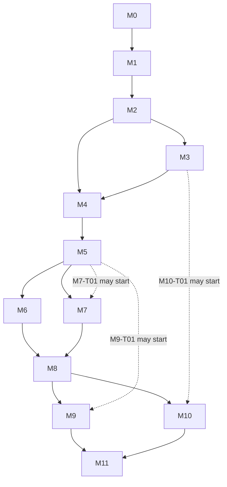

# Competitive Minesweeper Roadmap (Implementation Plan)

> **For agentic workers:** execute one task per conversation, starting from the milestone's handoff package in `docs/milestones/`. Use `executing-plans` (inline) or `subagent-driven-development` (fresh subagent per task plus reviewer). Every task is implemented with `test-driven-development`; the executing conversation expands the task's contract below into checkbox steps (failing test, run, implement, run, commit).

**Goal:** Ship a browser-based competitive Minesweeper (1v1 race on an identical seeded board, plus solo time-attack with leaderboards) to a small public launch, built so it can scale afterwards.

**Architecture:** pnpm TypeScript monorepo (`engine`, `protocol`, `server`, `web`). A pure deterministic engine; a server-authoritative Fastify + `ws` backend that never sends mine positions; a React/Canvas client that talks to a `GameSession` (local or remote).

**Tech Stack:** TypeScript (strict), pnpm workspaces, React + Vite, Canvas 2D, Tailwind, Fastify, `ws`, Zod, PostgreSQL + Drizzle, Better Auth, Vitest, Playwright, GitHub Actions, TSDoc + TypeDoc, Docker.

**Spec:** `docs/superpowers/specs/2026-11-04-competitive-minesweeper-design.md` (approved 2026-11-04). Executors read the spec and this plan together.

## Global Constraints

Every task's requirements implicitly include these lines.

- Language: TypeScript with `strict`, `noUncheckedIndexedAccess` and `exactOptionalPropertyTypes` enabled; Node LTS; pnpm workspaces.
- `packages/engine` imports nothing project-internal and uses no DOM APIs, Node APIs, clocks (`Date`, `performance`) or `Math.random`. Time enters only as `t` (milliseconds since game start) on a `Command`.
- `packages/protocol` imports only engine types. `apps/server` and `apps/web` depend on `engine` and `protocol`, never on each other.
- Mine positions never reach a client while a game is in progress. After a game ends, only the player's own finished game may expose its mines.
- Every inbound network message is validated against a Zod schema, size-limited and rate-limited before use.
- MVP modes: 1v1 `race` and solo `time-attack`. Fairness rule: seeded board with a guaranteed shared safe opening. Deferred: versus-with-attacks, shared board, spectating, no-guess boards.
- Solo developer; small public launch first. No Redis, message broker or multi-instance work before M11.
- Git: trunk-based, one task = one branch = one PR, squash-merge, Conventional Commits with the task ID (`feat(engine): iterative flood fill [M1-T04]`), `main` protected and green. Spec section 7.1.
- Code documentation: TSDoc on every exported symbol, inline comments explain why, every TODO names a task (`// TODO(M6-T04):`). Spec section 7.2. Acceptance for every task includes "exported symbols documented; lint and TypeDoc pass".
- Dependency versions are pinned at M0-T02 from current releases (prefer releases at least two weeks old) and re-verified when a package is first added.
- ADRs are append-only. A task that conflicts with an ADR stops and proposes a new ADR.

## Review Focus

Five conditions the spec implies but that no obvious happy-path test exercises, most likely to bite first. Each is pinned by a test in the owning task (marked "Review Focus #n" there).

1. **No-op commands:** revealing an already revealed or flagged cell, flagging a revealed cell, and chording with the wrong flag count change nothing and do not throw. Owners: M1-T04, M1-T05.
2. **Out-of-phase and out-of-order commands:** commands before the start signal, after game over, or with a duplicate or out-of-order `seq` are rejected without changing state. Owners: M1-T06, M5-T05, M6-T01, M6-T04.
3. **Simultaneous finish and ties:** two players finishing at the same server millisecond, or both hitting a mine, resolve by a fixed deterministic rule. Owners: M4-T03, M6-T05.
4. **Config extremes:** 1xN boards, single-cell boards, and a mine count that leaves too few cells for the safe opening are rejected with a clear error, never an infinite loop or a malformed board. Owners: M1-T01, M2-T02.
5. **Reconnect edge cases:** reconnecting during the countdown or at the instant of finishing, and opening the game in a second tab with the same token (takeover), leave exactly one live connection and a consistent result. Owners: M6-T02, M6-T04, M6-T05.

---

## A. Executive Summary

**Project.** An independent competitive Minesweeper for browsers, inspired by TETR.IO's competitive experience: real-time 1v1 races, ranked play, profiles, leaderboards, and a polished UI.

**Strategy.** Build a deterministic, UI-free engine first and test it hard. Layer a local client on top, then a server-authoritative network layer behind the same `GameSession` interface, then accounts, ranking and hosting. Deploy to a staging environment before visual polish so hosting problems surface early. Documentation, tests and code comments are produced inside each task, not at the end.

**MVP.** 1v1 race on an identical seeded board with a guaranteed shared safe opening; solo time-attack with replay-validated leaderboards; guest and registered accounts; rated 1v1 matchmaking; match history.

**Major technical challenges.**
1. Determinism across browsers and Node (golden-seed and replay tests, in-engine PRNG).
2. Fairness under latency (pipelined commands, server timestamps; accepted limitation D-10).
3. Reconnection and state consistency (sequence numbers, snapshots, fault-injection tests).
4. Cheating (hidden mines, replay validation, rate limits; solver bots are a known limit).
5. Staying lean as a solo developer (YAGNI per milestone; one process, one database).

## B. Game Design Proposal

Full comparison and rationale: spec section 2. Summary:

| Model | Verdict |
|---|---|
| Race on identical seeded board | MVP (1v1) |
| Time-attack score | MVP (solo, leaderboards) |
| Versus with attacks | First post-MVP mode (P10-A, begins with `/brainstorming`) |
| Shared board | Deferred, possibly never |

Race rules and presets are settled in M4-T03 (ADR-010). Chording and flag rules are settled in M1-T05 (ADR-009).

## C. Technology Stack

Full table with alternatives and trade-offs: spec section 5. Versions pinned at M0-T02. Decisions that remain open and when they are settled: hosting (ADR-014, M9-T02), auth methods (ADR-012, M7-T02), rating system (ADR-013, M8-T04).

## D. System Architecture

Diagrams (system flow, match lifecycle), patterns and data flow: spec section 4. Patterns used: Command, State, Strategy, Observer, Adapter, Repository.

### Canonical names

Tasks use these names exactly. A rename requires updating this table and every consumer in the same task.

| Package | Names |
|---|---|
| `engine` | `CellIndex` (number, `y * width + x`), `BoardConfig { width; height; mineCount }`, `PRESETS` (`beginner` 9x9/10, `intermediate` 16x16/40, `expert` 30x16/99), `InvalidBoardConfigError`, `Board`, `Game`, `GameStatus` (`'ready' \| 'playing' \| 'won' \| 'lost'`), `GameView`, `CellView`, `Command` (`{ type: 'reveal' \| 'flag' \| 'chord'; index: CellIndex; t: number }`), `GameEvent` (`CellsRevealed`, `FlagToggled`, `GameWon`, `GameLost`), `GameResult`, `Prng`, `createPrng`, `BoardGenerator`, `GeneratedBoard`, `SeededBoardGenerator`, `SafeOpeningPolicy`, `createGame`, `ReplayLog`, `replay`, `validateReplayLog`, `GameMode`, `ModeId` (`'race' \| 'time-attack'`), `PlayerResult`, `MatchOutcome`, `ModeRegistry`, `RaceMode`, `TimeAttackMode`, `GhostPlayer`, `Clock` (interface only) |
| `protocol` | `PROTOCOL_VERSION`, `ClientMessageSchema`, `ServerMessageSchema`, `encodeMessage`, `decodeMessage`, `Transport`, `InMemoryTransport`, `FaultyTransport` |
| `apps/web` | `GameSession`, `PlayerAction` (`{ type: Command['type']; index: CellIndex }`), `LocalSession`, `RemoteSession`, `ViewMirror`, `BoardRenderer`, `CanvasBoardRenderer`, `InputController`, `StatsStore`, `SystemClock` |
| `apps/server` | `Match`, `MatchState`, `MatchManager`, `Matchmaker`, `RatingSystem`, `Glicko2RatingSystem`, `ReplayValidator`, `StatsService`, `UserRepository`, `MatchRepository`, `ReplayRepository`, `SystemClock` |

### ADR plan

| ADR | Decision | Task |
|---|---|---|
| 001 | Monorepo and modular monolith | M0-T06 |
| 002 | Deterministic engine | M0-T06 |
| 003 | Server-authoritative play | M0-T06 |
| 004 | `GameSession` adapter | M0-T06 |
| 005 | Technology stack (incl. Better Auth re-verification) | M0-T06 |
| 006 | Git workflow | M0-T06 |
| 007 | Code documentation | M0-T06 |
| 008 | License | M0-T06 |
| 009 | Cell rules: chording and flags (D-04) | M1-T05 |
| 010 | Race rules and presets (D-01, D-02) | M4-T03 |
| 011 | Disconnect grace period (D-05) | M6-T03 |
| 012 | Auth methods (D-07) | M7-T02 |
| 013 | Rating system (D-06) | M8-T04 |
| 014 | Hosting provider (D-09) | M9-T02 |
| 015 | Platform priority and touch (D-08) | M10-T04 |
| 016 | Telemetry and privacy (new D-13) | M10-T07 |

New open decisions added by this plan: **D-12** license (ADR-008, M0-T06); **D-13** telemetry and privacy (ADR-016, M10-T07). D-03 (match format) is settled in M5-T04 as single-round and revisited in M8-T06. D-10 (ping fairness) is measured in M5-T08 and M11-T02 and recorded in `ARCHITECTURE.md` as a known limit. D-11 (capacity) is measured in M11-T02.

## E. Development Roadmap

### Milestone index

| ID | Milestone | Tasks | Depends on | Exit criteria |
|---|---|---|---|---|
| M0 | Foundations | 6 | spec approved | CI green on wired monorepo; docs and ADR-001..008 committed; tag `m0-complete` |
| M1 | Engine core | 7 | M0 | Playable-in-tests engine; public API exported and documented |
| M2 | Deterministic engine | 6 | M1 | Seeded boards, command log, replay; golden-seed tests pass in Node and a browser |
| M3 | Local solo client | 8 | M2 | Playable solo game in the browser; Playwright smoke test green |
| M4 | Mode framework and ghost race | 5 | M2, M3 | `GameMode` registry; race against your ghost; ADR-010 |
| M5 | First networked race | 8 | M4 | Two browsers race on localhost and a second LAN device |
| M6 | Match lifecycle and reconnection | 5 | M5 | Fault-injection suite green; ADR-011 |
| M7 | Accounts and persistence | 7 | M5 | Guests and registered users; matches and replays persisted; ADR-012 |
| M8 | Competitive layer | 7 | M6, M7 | Validated solo leaderboards; ranked 1v1; ADR-013 |
| M9 | Staging and hardening | 6 | M8 | Deployed staging with rate limits, anti-cheat flags, reviewed security; ADR-014 |
| M10 | Polish and alpha | 7 | M8 (T01 can start after M3) | Accessible, responsive, animated, with sound; alpha released; ADR-015, ADR-016 |
| M11 | Launch readiness | 6 | M9, M10 | Load tested, monitored, end-to-end suites green; public launch `v1.0.0` |

Per-milestone files: `docs/milestones/M0-foundations.md` through `M11-launch-readiness.md`. Each holds the Conversation Handoff Package and every task.

### Dependency graph

Tasks within a milestone run in numeric order unless a task's Prerequisites say otherwise. A solo developer should treat the dotted edges as optional parallelism, not a requirement.

### Post-launch backlog (Phase 10)

Each item begins with `/brainstorming` and gets its own spec before planning.

| ID | Item |
|---|---|
| P10-A | Versus-with-attacks mode (first post-MVP mode; `GameMode` strategy slot) |
| P10-B | Spectator mode |
| P10-C | Replay viewer |
| P10-D | Social features (friends, invites) |
| P10-E | Tournaments and community systems |
| P10-F | Scale-out (Redis, multiple server instances, sticky routing) |
| P10-G | No-guess board generator (`BoardGenerator` implementation) |
| P10-H | Binary protocol and bandwidth optimization |

## F. Cross-Conversation Workflow

Full rules: spec section 7. Operational summary:

**Documents (source of truth):** `README.md`, `PROJECT_OVERVIEW.md`, `ROADMAP.md` (status table), `ARCHITECTURE.md`, `DEVELOPMENT_GUIDE.md`, `DECISIONS.md`, `CHANGELOG.md`, `CLAUDE.md`, `docs/handoffs/`, `docs/milestones/`, `docs/superpowers/specs/`.

**Progress tracking:** `ROADMAP.md` holds one row per task with status (`Not started`, `In progress`, `Done`), the merged commit, and the date. M0-T05 creates it from the milestone index above.

**Task template (used by every task in the milestone files):** Objective, Description, Prerequisites, Implementation guidance, Expected output, Testing requirements, Acceptance criteria, Relevant skills, Documentation updates. The task ID is the heading.

**Conversation Handoff Package (one per milestone, at the top of each milestone file):**
1. Project context (about five lines).
2. The tasks to execute and their order.
3. Prerequisites and completed dependencies, with the baseline tag. The executing conversation must copy the *actual* exported signatures of dependencies from the code into its working notes.
4. Locked decisions (ADR IDs, "do not re-decide").
5. Expected deliverables.
6. Acceptance criteria for the milestone.
7. Required skills and when to use them.
8. Documents to consult first and to update at close-out.

**Per-task loop:** open a new conversation and paste the handoff plus the task heading; run `/using-git-worktrees` if isolation is wanted; implement with `/test-driven-development`; use `/systematic-debugging` for failures; verify with `/verification-before-completion`; open a PR; run `/requesting-code-review` at milestone end; close out (`ROADMAP`, `CHANGELOG`, `ARCHITECTURE` if an interface changed, `DECISIONS` if a decision was made); squash-merge; tag at milestone end.

**Preserving architectural consistency:** canonical names table above; append-only ADRs; single `index.ts` public API per package, guarded by an API-surface test (M1-T07); strict inward dependency rule enforced by lint (M0-T03).

## G. Risk Assessment

Spec section 9 holds the full table. Roadmap-specific additions:

| Risk | Where it bites | Mitigation |
|---|---|---|
| Architectural complexity | M5 introduces protocol, server and remote session at once | M5 is split into eight tasks with an in-memory transport first (M5-T02) so most logic is testable without sockets |
| Multiplayer synchronization | M5-T05, M6 | `FaultyTransport` fault injection (M6-T05); sequence numbers and snapshots |
| Competitive fairness | M4-T03, M5-T08, M11-T02 | Deterministic tie-break rule; measure ack latency; document D-10 limit |
| Security and cheating | M5-T05, M8-T01, M9 | No mine data in outbound messages (leak test); replay validation; rate limits; heuristic flags; known limit: solver bots |
| Performance | M3-T03, M10-T06, M11-T02 | Renderer benchmark on expert board; budgeted load test |
| Scope creep | Any milestone | Deferred list; new modes require an ADR and `/brainstorming` |
| Technical debt | Across conversations | Handoff template, API-surface test, docs updated in every task |
| Skill drift: a conversation ignores the docs | Any | `CLAUDE.md` read-order rule; "do not re-decide" list in each handoff |

## H. Initial Execution Plan

**First milestone: M0 Foundations.** Full tasks and handoff package: `docs/milestones/M0-foundations.md`.

- **Objectives:** a wired, empty monorepo with git conventions, code-documentation lint, CI, the documentation skeleton, and the first eight ADRs.
- **Prerequisites:** the approved spec; a GitHub account; Node LTS and pnpm installed locally.
- **Tasks:** M0-T01 repository and git conventions; M0-T02 monorepo scaffold and version pinning; M0-T03 lint, format, hooks and documentation lint; M0-T04 test tooling and CI; M0-T05 documentation skeleton; M0-T06 ADRs, dependency verification and license decision.
- **Expected deliverables:** GitHub repo with protected `main`; four empty packages that build and typecheck; green CI; documentation files; ADR-001..008; tag `m0-complete`.
- **Relevant skills:** `/using-git-worktrees` (optional), `/test-driven-development` (tooling smoke tests), `/architecture` (ADRs), `/documentation` (doc skeleton), `/verification-before-completion`, `/requesting-code-review`.
- **Acceptance criteria:** `pnpm install && pnpm typecheck && pnpm lint && pnpm test && pnpm docs:api` pass locally and in CI; a PR cannot merge with failing CI; a commit with a bad message or a bare TODO is rejected; docs and ADRs are committed.

## Self-review record

- **Spec coverage:** modes (M4, M5), fairness opening (M2-T02), determinism and replay (M2), authoritative server (M5), reconnection (M6), accounts and persistence (M7), leaderboards, rating, matchmaking (M8), deployment, anti-cheat, security (M9), polish and accessibility (M10), testing, monitoring, launch (M11), git (M0-T01, section 7.1), code documentation (M0-T03, section 7.2), cross-conversation workflow (M0-T05). Open decisions D-01..D-13 each have an owning task.
- **Type consistency:** names in milestone files follow the canonical names table.
- **Proportion:** tasks specify contracts (names, signatures, tests, acceptance), not code bodies.
