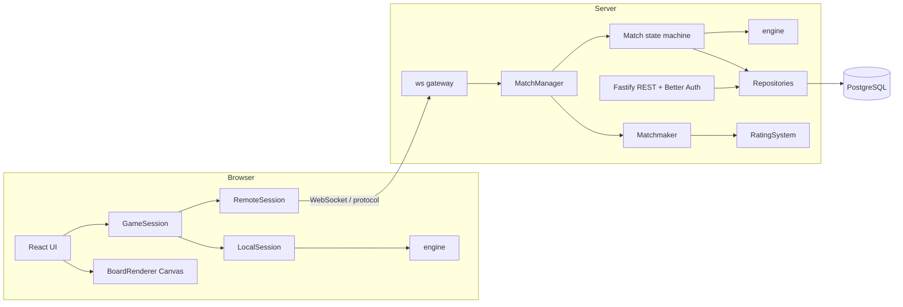
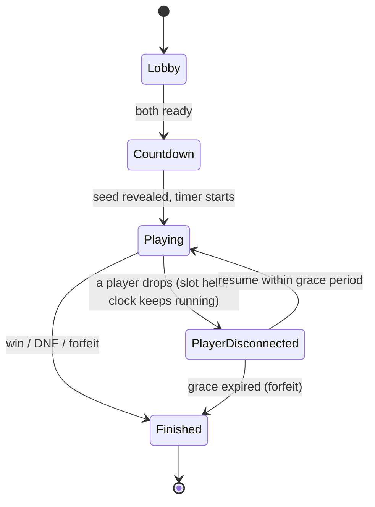

# Competitive Minesweeper: Design Spec

Status: **Approved with amendments** (2026-11-04). Amendments made at review: git version control (section 7.1) and code-documentation rules (section 7.2).
Next step after approval: `/writing-plans` produces the full roadmap (milestones, tasks, handoff packages).

## 1. Purpose and scope

An independent, browser-based competitive Minesweeper game, inspired by the competitive experience of TETR.IO (modes, real-time multiplayer, profiles, ranking, leaderboards, polish), not a copy of it.

**Team and scale (decided):** solo developer. Plan for a small public launch first, then scale up seriously. No infrastructure beyond what a small launch needs; clean seams so scaling later does not force rewrites.

**Core technology direction (decided):** TypeScript everywhere, OOP architecture, modular and extensible, incremental milestones, engine independent of UI and networking.

## 2. Game design

### 2.1 Models considered

| Model | Fairness | Sync cost | Fun / depth | Verdict |
|---|---|---|---|---|
| Race on an identical seeded board | High | Low (progress events + validated command log) | Medium; low interaction | **MVP** |
| Versus with attacks (TETR.IO-style) | Medium; balance-sensitive | Medium | High | First post-MVP mode |
| Shared board (claim cells) | Low-medium; latency-sensitive | High (arbitration) | High, novel | Later, if ever |
| Time-attack score | High | Minimal | Medium | **MVP (solo)** |

### 2.2 MVP modes (decided)
- **1v1 Race:** both players receive the same seeded board and the same guaranteed safe opening. Fastest clear wins.
- **Solo Time-Attack:** single-player timed play with leaderboards; ranked runs are validated by replaying the submitted command log on the server.

### 2.3 Fairness rule (decided)
**Guaranteed shared opening:** the seeded generator produces a board with a fixed safe opening region revealed at start for every player. No luck at the start; no per-player mine relocation. The generator sits behind a `BoardGenerator` interface so a no-guess generator can replace it later.

### 2.4 Deferred
Versus-with-attacks, shared board, spectating, replay viewer, social features, tournaments, no-guess boards.

## 3. Assumptions and open decisions

These are not finalized. Each becomes an ADR when settled; the owning milestone is in brackets.

| ID | Item | Working assumption |
|---|---|---|
| D-01 | Board presets | Classic three: 9x9/10, 16x16/40, 30x16/99. Ranked race preset undecided. [M4] |
| D-02 | Mine hit in a race | Hitting a mine ends your run (DNF). If both DNF, more safe cells revealed wins. Alternative: time penalty and continue. [M4] |
| D-03 | Match format | Single round for the first networked race; best-of-N as a configurable `MatchRules` value later. [M5/M8] |
| D-04 | Chording and flags | Chording allowed; flags allowed but never required to win; no question marks. [M1] |
| D-05 | Disconnect grace period | 30 seconds to resume before forfeit. [M6] |
| D-06 | Rating system | Glicko-2 behind a `RatingSystem` strategy; final choice at M8. [M8] |
| D-07 | Auth methods | Guests plus email/password at launch; OAuth providers undecided. [M7] |
| D-08 | Platform priority | Desktop-first; mobile and touch controls at M10. [M10] |
| D-09 | Hosting provider | Single container on a VPS or PaaS; provider undecided. [M9] |
| D-10 | Ping fairness | Higher-latency players are disadvantaged; command pipelining and server timestamps mitigate but do not eliminate. Accepted for MVP. [M5] |
| D-11 | Capacity target | About 200 concurrent matches on one small instance. [M11] |

## 4. Architecture

### 4.1 Principles
1. **Deterministic engine:** `(seed, config, commands) -> state`. No clocks, no `Math.random`, no DOM, no Node APIs. Time is supplied by the caller as a timestamp on each command. The PRNG is implemented inside the engine using integer arithmetic.
2. **Server-authoritative play:** the server holds the real board; clients receive only revealed cells. Mine positions never reach the browser during a match.
3. **One session interface:** the UI talks to `GameSession`. `LocalSession` runs the engine in the browser; `RemoteSession` speaks the protocol over WebSocket. Moving from local to LAN to online changes the session, not the UI.
4. **Replay-based validation:** every game is a command log. Ranked solo runs are verified by replaying the log through the same engine.
5. **Strict inward dependencies:** `engine` imports nothing project-internal; `protocol` imports only engine types; `server` and `web` depend on both.

### 4.2 Package layout (pnpm workspaces)
```
packages/engine     pure TypeScript game logic
packages/protocol   message schemas (Zod) and shared types
apps/server         Fastify (REST) + ws (game sockets), Better Auth, Drizzle
apps/web            React + Vite client, Canvas 2D board renderer
docs/               project documentation (section 7)
```

### 4.3 System diagram


### 4.4 Match lifecycle (State pattern)


The race clock never pauses: a player who drops keeps their slot for the grace period (D-05) but loses time while away, which keeps the race fair to the opponent.

### 4.5 Engine domain model
- `BoardConfig` (width, height, mineCount), `Board`, `Cell` (index-addressed, state enum: hidden, revealed, flagged).
- `BoardGenerator` (interface); `SeededBoardGenerator` with an in-engine PRNG and `SafeOpeningPolicy`.
- `Game` (aggregate): `apply(command): GameEvent[]`; owns win/loss detection.
- Commands: `Reveal`, `Flag`, `Chord`, each with `{ index, t }`. Events: `CellsRevealed`, `FlagToggled`, `GameWon`, `GameLost`.
- `GameMode` (Strategy): rules, scoring, result evaluation. `RaceMode`, `TimeAttackMode`.
- Flood fill is iterative (explicit stack), not recursive.

### 4.6 Data flow: one race click
1. Client click -> `RemoteSession` sends `{ type: "cmd", seq, cmd }` without waiting for earlier acks (pipelining).
2. Server validates the message against the Zod schema, rate-limits, stamps receive time.
3. `Match` routes the command to that player's `Game`; the engine returns events.
4. Server sends the acting player the newly revealed cells (and their values) and the opponent only a progress count.
5. On a win or DNF the server finalizes the result, persists the match and both command logs, and updates ratings.

### 4.7 Reconnection
Each player holds a resume token and the last acknowledged `seq`. On reconnect within the grace period (D-05) the server sends a snapshot of that player's revealed state and resumes the match.

### 4.8 Design patterns (and what is deliberately not used)
| Pattern | Where | Simpler alternative |
|---|---|---|
| Command | Engine actions, replay, wire format | None; backbone |
| State | Match lifecycle; client screen flow (enum + switch is enough there) | Enum + switch |
| Strategy | `GameMode`, `BoardGenerator`, `RatingSystem` | Config flags (insufficient once versus mode exists) |
| Observer | Engine events to renderer, audio, network, stats | Typed event emitter, no framework |
| Adapter | `GameSession` (Local/Remote), `Transport` over WebSocket | None; the local-to-online seam |
| Repository | `UserRepository`, `MatchRepository`, `ReplayRepository` | Thin data-access module |

Not used: Singleton, Visitor, Decorator, a Factory for cells. A small registry maps a mode id to a `GameMode`.

## 5. Technology stack

Versions are pinned at scaffold time (M0) from current releases.

| Layer | Choice | Main alternative and trade-off |
|---|---|---|
| Repo | pnpm workspaces, Node LTS, strict TypeScript | Turborepo later if builds slow |
| Client | React + Vite, Zustand | Svelte/Solid are lighter; React has the larger ecosystem |
| Rendering | Canvas 2D behind `BoardRenderer` | DOM grid is simpler but hits animation limits; PixiJS if needed |
| Styling | Tailwind CSS + CSS-variable tokens, Radix primitives | Full component libraries constrain the game's look |
| Server | Fastify + `ws` in one process | Socket.IO (heavier protocol), Colyseus (schema sync fights the deterministic engine) |
| Validation | Zod in `protocol` | Hand-written guards drift |
| Database | PostgreSQL + Drizzle | Prisma: more tooling, heavier runtime |
| Cache/broker | None at MVP; Redis when running multiple instances | |
| Auth | Better Auth (self-hosted, anonymous-session plugin for guests) | Roll-your-own sessions: more security surface. Lucia is no longer maintained; Auth.js is in maintenance mode. Re-verify Better Auth's status at M0. |
| Testing | Vitest, Playwright | Jest needs more ESM configuration |
| Quality/CI | ESLint, Prettier, GitHub Actions | Biome |
| Version control | Git on GitHub; trunk-based with short-lived branches, Conventional Commits, one PR per task (section 7.1) | GitFlow adds release branches a solo project does not need |
| Code documentation | TSDoc comments enforced by `eslint-plugin-tsdoc` and `eslint-plugin-jsdoc`; API reference generated by TypeDoc (section 7.2) | Doxygen targets C-family languages and has no first-class TypeScript support; TSDoc + TypeDoc is the TypeScript equivalent |
| Hosting | Docker on a VPS/PaaS, managed Postgres, CDN for client | Kubernetes is premature |
| Observability | pino, Sentry | Prometheus/Grafana in M11 if needed |

## 6. Roadmap sequence

Reorganized from the brief's Phases 0-10 around dependencies. Details (milestones, tasks, acceptance criteria, handoff packages) come from `/writing-plans`.

| Milestone | Brief phase | Content |
|---|---|---|
| M0 | 0, 1 | Foundations: spec, docs skeleton, repo scaffold, git workflow, code-documentation rules and lint, CI, conventions |
| M1 | 2 | Engine core: board, reveal, flood fill, flags, chording, win/loss |
| M2 | 2 | Deterministic engine: seeded generator with guaranteed opening, command log, replay, scoring |
| M3 | 3 | Local solo client with difficulty, restart, basic stats, design tokens, a11y basics |
| M4 | 4 (reframed) | `GameMode` framework; race against a recorded ghost |
| M5 | 5, 6 | Protocol, authoritative server, `RemoteSession`: first networked race on localhost/LAN |
| M6 | 5, 6 | Match lifecycle, reconnection, forfeit |
| M7 | 6 | Accounts (guests + registered), persistence, match history, replay storage |
| M8 | 7 | Solo leaderboards with replay validation, matchmaking, rating, ranked 1v1 |
| M9 | 6, 7, 9 | Staging deployment, anti-cheat basics, rate limits, security review |
| M10 | 8 | Visual identity, animation, sound, responsive/mobile, accessibility pass, alpha |
| M11 | 9 | Load tests, monitoring, end-to-end suites, public launch |
| Post | 10 | Versus-with-attacks, spectators, replay viewer, social, tournaments |

Deviations from the brief: Phase 4 (local multiplayer) becomes a ghost race because hot-seat play does not fit an identical-board race; Phase 5 (LAN) merges into the online phase (LAN is the server on a local network); deployment happens before polish. Testing and documentation run through every milestone.

## 7. Cross-conversation workflow

**Docs (source of truth):** `README.md`, `PROJECT_OVERVIEW.md`, `ROADMAP.md`, `ARCHITECTURE.md`, `DEVELOPMENT_GUIDE.md`, `DECISIONS.md`, `CHANGELOG.md`, plus `CLAUDE.md` (read order and commands), `docs/handoffs/<milestone>.md`, `docs/specs/`.

**Tracking:** tasks are `M<n>-T<nn>`; `ROADMAP.md` holds the only status table.

**Handoff package (fixed template):** project context (~10 lines); exact task(s); completed dependencies with actual exported signatures copied from code; locked decisions as ADR IDs ("do not re-decide"); deliverables and acceptance criteria; skills to invoke; docs to read first and update last.

**Per-task loop:** new conversation with the handoff pasted; `/test-driven-development` to implement; `/systematic-debugging` on failures; `/verification-before-completion` against acceptance criteria; `/requesting-code-review` at milestone end; close-out updates `ROADMAP`, `CHANGELOG`, `ARCHITECTURE` (if interfaces changed), `DECISIONS` (if a decision was made); commit.

**Consistency rules:** ADRs are append-only (superseded, never edited); a task that conflicts with an ADR stops and proposes a new ADR; `engine` and `protocol` expose their public API from one index file each; open decisions live in `DECISIONS.md`.

**Other skills used where relevant:** `/frontend-design` (M3, M10), `/accessibility-review` (M10), `/deploy-checklist` (M9, M11), `/testing-strategy` (M11), `/architecture` (ADRs), `/using-git-worktrees` and `/subagent-driven-development` or `/executing-plans` for plan execution.

### 7.1 Version control (git)
- **Hosting:** a GitHub repository. `main` is protected and always green (CI is a required check). History on `main` is never rewritten.
- **Branching:** trunk-based. One task = one short-lived branch = one pull request. Branch names: `m<n>/<task-id>-<slug>`, for example `m1/M1-T04-flood-fill`. Even as a solo developer, the PR is the review gate where CI and `/requesting-code-review` run. `/using-git-worktrees` gives isolated workspaces for parallel tasks.
- **Merging:** squash-merge, so each task is one commit on `main`.
- **Commits:** Conventional Commits (`feat`, `fix`, `refactor`, `test`, `docs`, `chore`, `ci`), scope = package (`engine`, `protocol`, `server`, `web`, `docs`), task ID in the subject: `feat(engine): iterative flood fill [M1-T04]`. Enforced by commitlint in a `commit-msg` hook.
- **Hooks (husky + lint-staged):** pre-commit runs ESLint, Prettier and type-check on staged files; pre-push runs unit tests for affected packages. CI is the authority; hooks are fast feedback.
- **Tags and releases:** tag each completed milestone `m<n>-complete`. Pre-launch releases are `v0.<n>.0`; semantic versioning starts at `v1.0.0` at public launch. Handoff packages cite the baseline tag or commit SHA so a new conversation starts from known code.
- **Hygiene:** `.gitignore`, `.gitattributes` (LF line endings), `.editorconfig`. No secrets in git (`.env.example` only; real values live in host secrets). No generated artifacts committed (build output, TypeDoc output, coverage).
- **Changelog:** drafted from conventional commits at task close-out, then curated by hand.

### 7.2 Code documentation
- **Doc comments:** every exported class, interface, type, function, enum and constant has a TSDoc comment (`/** ... */`): a one-sentence summary, then `@param`, `@returns` and `@throws` where applicable. `@example` is required on the public API of `engine` and `protocol`; `@remarks` records invariants and contracts (for example "must stay deterministic"); `@internal` marks members exported only for tests; `@deprecated` names the replacement.
- **Non-exported code** is documented whenever its purpose is not obvious from its name.
- **Inline comments explain why, not what.** They are required for non-obvious algorithms (flood fill, PRNG, opening policy, rating math, reconnection), invariants, performance trade-offs, and workarounds (with a link). Commented-out code is not allowed (git keeps history). Every TODO names a task: `// TODO(M6-T04): ...`; CI fails on a bare TODO.
- **Enforcement:** `eslint-plugin-tsdoc` validates comment syntax everywhere. `eslint-plugin-jsdoc` requires doc comments on exports in `packages/engine` and `packages/protocol` (error) and in `apps/*` (warning until M5, error afterwards). TypeDoc builds the API reference for `engine` and `protocol` in CI with warnings treated as errors; the output is a build artifact and is not committed.
- **Doxygen:** not used. It targets C-family languages and has no first-class TypeScript support. TSDoc + TypeDoc gives the same result: structured doc comments rendered as an HTML reference.
- **Definition of done:** every task's acceptance criteria include "exported symbols documented; lint and TypeDoc pass".
- **Style:** English, present tense, concise.

## 8. Requirements

**Functional (MVP):** play solo with the three presets; race a ghost; race a human 1v1; accounts and guest play; match history; solo leaderboards; ranked 1v1 with a rating; replays stored and validated.

**Non-functional:**
- Engine: deterministic across browsers and Node; a 30x16 reveal and flood fill completes well under one frame (16 ms).
- Network: reveal acknowledgment p95 under 150 ms within one region (target, measured in M5 and M11).
- Security: mines never sent to clients mid-match; all inbound messages schema-validated and rate-limited; passwords and sessions handled by the auth library, not custom code.
- Maintainability: engine and protocol covered by unit tests, including determinism and replay round-trip tests; every public interface documented in `ARCHITECTURE.md`; every exported symbol carries a TSDoc comment (section 7.2).
- Accessibility: keyboard play and screen-reader basics from M3; full pass in M10.

## 9. Risks and mitigations

| Risk | Mitigation |
|---|---|
| Over-engineering for a solo developer | Strict YAGNI per milestone; one process, one database; defer Redis, microservices, binary protocols |
| Determinism bugs (platform-dependent behavior) | In-engine integer PRNG, no clocks or `Math.random`, golden-seed tests run in CI on Node and in a browser |
| Latency unfairness in races (D-10) | Pipelined commands, server timestamps, documented limitation; revisit measurement at M5 and M11 |
| Cheating by solver bots | Out of detection scope for MVP; mitigated by hidden mines, rate limits, impossible-speed flagging, replay audits; record as a known limit |
| Fairness of the shared opening | Fixed seed and opening policy covered by generator tests; no per-player randomness |
| Reconnection and state desync | Sequence numbers, snapshots on resume, integration tests simulating drops |
| Scope creep | Deferred list in section 2.4; new modes require an ADR |
| Technical debt across many conversations | Handoff template, append-only ADRs, docs updated at every close-out |
| Auth library churn | Re-verify at M0; keep auth behind a thin interface |

## 10. First milestone after approval

**M0 Foundations:** initialize the git repository with its conventions (section 7.1), scaffold the pnpm monorepo, configure TypeScript, ESLint (including the TSDoc rules of section 7.2), Prettier, hooks, Vitest and CI, create the documentation skeleton from this spec, pin dependency versions from current releases, re-verify Better Auth, and write ADR-001 through ADR-008 (monorepo, deterministic engine, server-authoritative play, session interface, stack, git workflow, code documentation, license). Acceptance: CI green on an empty-but-wired monorepo, docs present, ADRs committed, tag `m0-complete`. The full task breakdown is in the roadmap plan.
